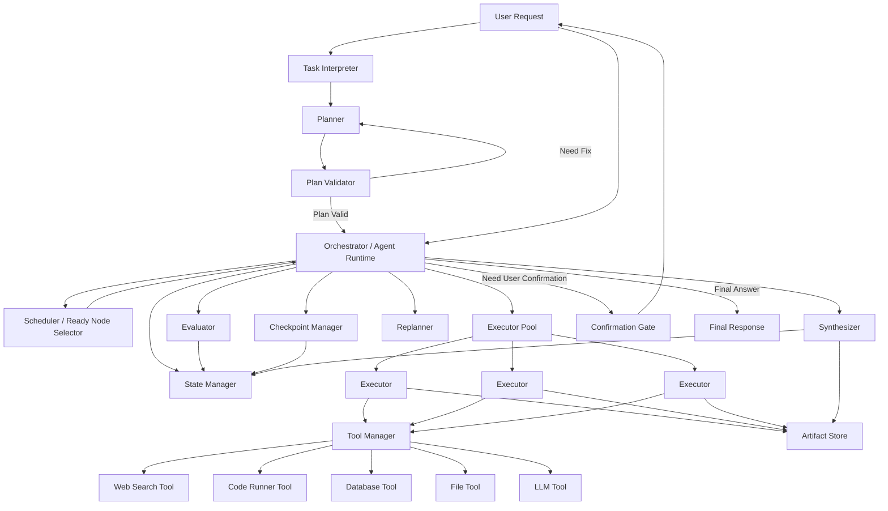
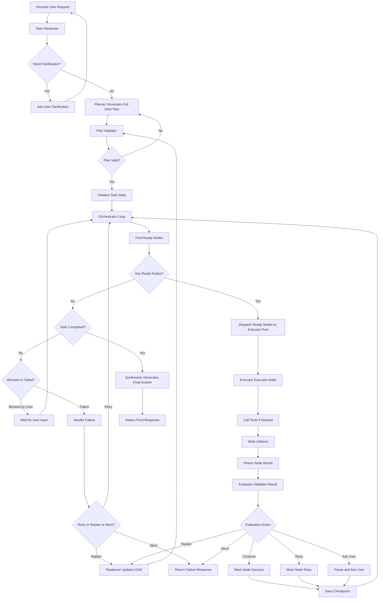

# 1. 总体架构图



> 这里的 `Scheduler` 可以先做成 `Orchestrator` 内部函数，不一定要独立成类。

---

# 2. 核心执行流程图



---

# 3. 最终推荐组件清单

## 必需组件

| 组件 | 是否必须 | 职责 |
|---|---:|---|
| `Task Interpreter` | 推荐 | 解析用户意图、实体、约束、缺失信息、候选 assumptions |
| `Planner` | 必须 | 一次性生成完整 DAG Plan |
| `Plan Validator` | 必须 | 校验 DAG、节点、依赖、工具、contract 是否合法 |
| `Orchestrator` | 必须 | 整体统筹推进任务 |
| `State Manager` | 必须 | 管理任务状态、DAG 状态、节点状态 |
| `Executor` | 必须 | 执行单个 DAG Node |
| `Tool Manager` | 必须 | 管理和调用工具 |
| `Artifact Store` | 必须 | 保存节点产物 |
| `Evaluator` | 必须 | 判断节点结果是否合格 |
| `Synthesizer` | 必须 | 汇总最终结果并生成用户答案 |

---

## 强烈推荐组件

| 组件 | 职责 |
|---|---|
| `Checkpoint Manager` | 保存任务执行快照，支持恢复 |
| `Confirmation Gate` | 高风险动作前请求用户确认 |
| `Replanner` | 在执行失败或计划失效时修订 DAG |
| `Executor Pool` | 支持并行执行多个 ready nodes |
| `Schema Registry` | 管理不同 artifact/output contract schema |
| `Output Validator` | 根据 output contract 校验节点输出 |
| `Event Log` | 记录所有状态变化和执行轨迹 |

---

## 可选组件

| 组件 | 什么时候需要 |
|---|---|
| `Scheduler` | DAG 并行、优先级、资源约束复杂时 |
| `Reducer` | 多个并行节点输出需要结构化合并时 |
| `Memory Store` | 需要跨任务保存用户偏好、长期经验时 |
| `Policy Engine` | 权限、安全、合规要求复杂时 |
| `Human Review Queue` | 需要人工审核时 |

---

# 4. 各组件职责边界

## 4.1 `Task Interpreter`

负责把用户请求转成结构化任务理解。

输入：

```json
{
  "user_request": "帮我分析苹果公司最近三年的财报风险"
}
```

输出：

```json
{
  "intent": "financial_analysis",
  "entities": {
    "company": "苹果公司"
  },
  "constraints": {
    "language": "zh-CN",
    "output_format": "markdown"
  },
  "candidate_assumptions": [
    "苹果公司指 Apple Inc.",
    "最近三年指最近三个完整财年",
    "默认使用公开官方财报和监管文件"
  ],
  "missing_info": [],
  "needs_clarification": false,
  "clarification_questions": []
}
```

---

## 4.2 `Planner`

负责一次性生成完整 DAG。

它不执行工具，不编造结果。

输入：

```json
{
  "task_understanding": {},
  "available_tools": [],
  "available_artifact_schemas": [],
  "planning_constraints": {
    "max_nodes": 20,
    "max_parallel_branches": 5,
    "allow_replan": true
  }
}
```

输出：

```json
{
  "plan_id": "plan_001",
  "goal": "分析 Apple Inc. 最近三年的财务表现和风险",
  "assumptions": [
    "苹果公司指 Apple Inc.",
    "最近三年指最近三个完整财年",
    "默认使用公开官方财报和监管文件"
  ],
  "dag": {
    "nodes": [],
    "edges": []
  },
  "final_output_contract": {}
}
```

---

## 4.3 `Plan Validator`

负责检查 Planner 生成的 DAG 是否能执行。

主要检查：

1. DAG 是否有环
2. 所有 node id 是否唯一
3. dependencies 是否存在
4. 工具是否存在
5. input 是否满足工具 schema
6. output contract 是否合法
7. 是否存在孤立但无意义节点
8. 是否存在不可达节点
9. 高风险节点是否有 confirmation gate
10. 是否超过 max nodes、max depth、max parallelism

输出：

```json
{
  "valid": false,
  "issues": [
    {
      "type": "missing_tool",
      "node_id": "download_report",
      "message": "tool annual_report_downloader does not exist"
    }
  ],
  "action": "fix_plan"
}
```

---

## 4.4 `Orchestrator`

这是整个系统的核心总控。

负责：

1. 初始化任务状态
2. 加载 DAG
3. 找 ready nodes
4. 调用 Executor Pool
5. 调用 Evaluator
6. 更新 State
7. 写 checkpoint
8. 处理 retry
9. 触发 replan
10. 处理 confirmation gate
11. 判断任务完成
12. 调用 Synthesizer

---

## 4.5 `Scheduler`

如果简单，可以内嵌在 `Orchestrator` 中。

职责是：

```text
从 DAG 中找出当前可以执行的节点。
```

例如：

```python
def get_ready_nodes(state):
    ready_nodes = []

    for node in state.dag.nodes:
        if node.status != "pending":
            continue

        deps_satisfied = all(
            state.node_states[dep].status == "success"
            for dep in node.dependencies
        )

        if deps_satisfied:
            ready_nodes.append(node)

    return ready_nodes
```

如果复杂，再独立成 `Scheduler` 类，增加：

- 并发限制
- 优先级
- 资源约束
- 工具配额
- retry queue
- timeout 检测

---

## 4.6 `Executor`

Executor 只执行单个 Node。

输入：

```json
{
  "node": {},
  "resolved_inputs": {},
  "state_snapshot": {},
  "tool_registry": []
}
```

输出：

```json
{
  "node_id": "extract_metrics_2024",
  "status": "success",
  "artifact_refs": [
    "artifact_metrics_2024"
  ],
  "summary": "成功提取 2024 财年核心财务指标",
  "tool_calls": [],
  "error": null,
  "recommendation": "continue"
}
```

Executor 可以做局部 retry，但不应该擅自改 DAG。

---

## 4.7 `Tool Manager`

负责工具注册、参数校验、调用、权限控制、返回结果标准化。

```text
Executor 不直接调用具体工具
Executor 调用 Tool Manager
Tool Manager 调用真实工具
```

这样便于：

- 工具权限控制
- 日志追踪
- schema 校验
- 超时控制
- retry
- mock 测试

---

## 4.8 `Artifact Store`

保存节点产物。

例如：

- 搜索结果
- 文档全文
- 表格
- 代码补丁
- 图片
- 中间分析结果
- 聚合结果
- 草稿

Node State 中只保存 artifact 引用：

```json
{
  "node_id": "parse_annual_report_2024",
  "status": "success",
  "artifact_refs": [
    "artifact_report_text_2024",
    "artifact_financial_tables_2024"
  ]
}
```

Artifact Store 中保存真实内容：

```json
{
  "artifact_id": "artifact_financial_tables_2024",
  "type": "financial_tables",
  "content": {},
  "metadata": {
    "source_url": "https://...",
    "created_by_node": "parse_annual_report_2024"
  }
}
```

---

## 4.9 `Evaluator`

判断节点结果是否满足 `output_contract` 和 `success_criteria`。

推荐输出：

```json
{
  "node_id": "extract_metrics_2024",
  "passed": true,
  "action": "continue",
  "reason": "输出满足 financial_metrics schema，且包含 revenue、net_income、operating_cash_flow",
  "issues": [],
  "evidence": {
    "schema_valid": true,
    "required_fields_present": true
  },
  "confidence": "high"
}
```

失败时：

```json
{
  "node_id": "extract_metrics_2024",
  "passed": false,
  "action": "retry",
  "reason": "缺少 operating_cash_flow 字段",
  "issues": [
    {
      "type": "missing_required_data",
      "severity": "medium",
      "recoverable": true,
      "message": "未能从财报中提取经营现金流"
    }
  ],
  "suggested_fix": {
    "type": "adjust_input",
    "details": "尝试解析现金流量表页面"
  }
}
```

---

## 4.10 `Replanner`

虽然你说不用分层 Planner，但仍然建议保留 `Replanner`。

它不是分层 Planner，而是当原计划失效时，对整个 DAG 或部分 DAG 做修订。

触发条件：

- 工具不可用
- 节点连续失败
- 找不到必要数据
- 发现 assumptions 不成立
- 用户修改需求
- 高风险操作被用户拒绝
- 后续节点依赖无法满足

输出可以是完整新 DAG，也可以是 DAG Patch。

推荐输出 DAG Patch：

```json
{
  "patch_type": "replace_nodes",
  "reason": "官方财报下载失败，改用 SEC filings 数据源",
  "remove_nodes": [
    "download_from_investor_relations"
  ],
  "add_nodes": [
    {
      "id": "search_sec_filings",
      "title": "从 SEC 检索年报",
      "type": "search",
      "tool": "sec_search",
      "dependencies": []
    }
  ],
  "update_edges": []
}
```

---

## 4.11 `Checkpoint Manager`

负责保存任务快照。

例如每轮 DAG 推进后保存：

```json
{
  "checkpoint_id": "ckpt_008",
  "task_id": "task_001",
  "plan_version": 2,
  "node_states": {},
  "artifact_refs": [],
  "event_offset": 128,
  "created_at": "2026-06-11T10:00:00Z"
}
```

作用：

- 系统崩溃后恢复
- 长任务暂停继续
- 回滚到某个点
- 调试和复现

---

## 4.12 `Synthesizer`

最终汇总结果。

它读取：

1. Global State
2. DAG State
3. Node State
4. Artifact Store
5. 用户约束
6. final output contract

然后生成最终答案。

它不应该伪造未完成节点的结果。  
如果部分节点失败，应如实说明。

---

# 5. 推荐数据结构

## 5.1 Plan DAG

```json
{
  "plan_id": "plan_001",
  "goal": "分析 Apple Inc. 最近三年的财报风险",
  "assumptions": [
    "苹果公司指 Apple Inc.",
    "最近三年指最近三个完整财年",
    "默认使用公开官方财报和监管文件"
  ],
  "dag": {
    "nodes": [
      {
        "id": "search_reports",
        "title": "检索最近三年年报",
        "type": "search",
        "tool": "web_search",
        "dependencies": [],
        "input": {
          "query": "Apple annual report 2023 2024 2025 official"
        },
        "output_contract": {
          "artifact_type": "source_list",
          "schema_ref": "schemas/source_list.v1",
          "success_criteria": [
            "至少包含最近三个完整财年的年报来源",
            "至少一个来源来自 Apple 官方或 SEC"
          ]
        },
        "risk_level": "low",
        "requires_user_confirmation": false,
        "max_retries": 2
      },
      {
        "id": "extract_metrics",
        "title": "提取核心财务指标",
        "type": "extract",
        "tool": "document_parser",
        "dependencies": [
          "search_reports"
        ],
        "input_refs": [
          "search_reports.output"
        ],
        "output_contract": {
          "artifact_type": "financial_metrics_series",
          "schema_ref": "schemas/financial_metrics_series.v1",
          "success_criteria": [
            "必须覆盖最近三个完整财年",
            "每个财年至少包含 revenue、net_income、operating_cash_flow",
            "所有数值必须保留来源引用"
          ]
        },
        "risk_level": "low",
        "requires_user_confirmation": false,
        "max_retries": 2
      },
      {
        "id": "analyze_risks",
        "title": "分析财务风险",
        "type": "analysis",
        "tool": "llm_reasoner",
        "dependencies": [
          "extract_metrics"
        ],
        "input_refs": [
          "extract_metrics.output"
        ],
        "output_contract": {
          "artifact_type": "risk_analysis",
          "schema_ref": "schemas/risk_analysis.v1",
          "success_criteria": [
            "必须包含收入增长、利润率、现金流、负债、业务集中度风险",
            "每个风险点必须引用财务指标或来源"
          ]
        },
        "risk_level": "low",
        "requires_user_confirmation": false,
        "max_retries": 1
      },
      {
        "id": "generate_report",
        "title": "生成最终分析报告",
        "type": "synthesize",
        "tool": "llm_writer",
        "dependencies": [
          "analyze_risks"
        ],
        "input_refs": [
          "extract_metrics.output",
          "analyze_risks.output"
        ],
        "output_contract": {
          "artifact_type": "final_report",
          "schema_ref": "schemas/final_report.v1",
          "success_criteria": [
            "使用中文 Markdown",
            "包含结论、核心数据、风险分析、建议",
            "不得遗漏数据来源"
          ]
        },
        "risk_level": "low",
        "requires_user_confirmation": false,
        "max_retries": 1
      }
    ],
    "edges": [
      {
        "from": "search_reports",
        "to": "extract_metrics"
      },
      {
        "from": "extract_metrics",
        "to": "analyze_risks"
      },
      {
        "from": "analyze_risks",
        "to": "generate_report"
      }
    ]
  },
  "final_output_contract": {
    "format": "markdown",
    "language": "zh-CN",
    "sections": [
      "结论",
      "核心财务数据",
      "主要风险",
      "建议",
      "数据来源"
    ]
  }
}
```

---

## 5.2 Task State

```json
{
  "task_id": "task_001",
  "status": "running",
  "user_request": "帮我分析苹果公司最近三年的财报风险",
  "plan_id": "plan_001",
  "plan_version": 1,
  "current_phase": "executing",
  "created_at": "2026-06-11T10:00:00Z",
  "updated_at": "2026-06-11T10:05:00Z",
  "waiting_for_user": false,
  "final_result_ref": null
}
```

---

## 5.3 Node State

```json
{
  "node_id": "extract_metrics",
  "status": "success",
  "attempt": 1,
  "started_at": "2026-06-11T10:01:00Z",
  "finished_at": "2026-06-11T10:02:00Z",
  "artifact_refs": [
    "artifact_financial_metrics_series_001"
  ],
  "summary": "已提取最近三年 revenue、net_income、operating_cash_flow",
  "error": null
}
```

---

## 5.4 Artifact

```json
{
  "artifact_id": "artifact_financial_metrics_series_001",
  "type": "financial_metrics_series",
  "schema_ref": "schemas/financial_metrics_series.v1",
  "content": {
    "company": "Apple Inc.",
    "currency": "USD",
    "items": [
      {
        "fiscal_year": 2023,
        "revenue": 383285,
        "net_income": 96995,
        "operating_cash_flow": 110543,
        "source_refs": [
          "artifact_source_2023_10k"
        ]
      }
    ]
  },
  "metadata": {
    "created_by_node": "extract_metrics",
    "created_at": "2026-06-11T10:02:00Z"
  }
}
```

---

# 6. Orchestrator 主循环

```python
class Orchestrator:
    def run(self, task_id: str):
        state = self.state_manager.load(task_id)

        while not state.is_terminal():
            ready_nodes = self.get_ready_nodes(state)

            if not ready_nodes:
                if self.is_task_complete(state):
                    break

                if self.has_blocked_nodes(state):
                    self.handle_blocked(state)
                    return

                if self.has_failed_nodes(state):
                    self.handle_failure(state)
                    continue

                self.state_manager.mark_task_failed(
                    task_id,
                    reason="No ready nodes and task is not complete"
                )
                return

            for node in ready_nodes:
                if node.requires_user_confirmation:
                    self.pause_for_confirmation(task_id, node)
                    return

            results = self.executor_pool.run(ready_nodes, state)

            for result in results:
                evaluation = self.evaluator.evaluate(
                    node_id=result.node_id,
                    result=result,
                    state=state
                )

                self.apply_evaluation(
                    task_id=task_id,
                    result=result,
                    evaluation=evaluation
                )

            self.checkpoint_manager.save(task_id)

            state = self.state_manager.load(task_id)

        final_answer = self.synthesizer.synthesize(state)
        self.state_manager.mark_task_success(
            task_id,
            final_result=final_answer
        )

        return final_answer

    def get_ready_nodes(self, state):
        ready_nodes = []

        for node in state.plan.dag.nodes:
            node_state = state.node_states[node.id]

            if node_state.status != "pending":
                continue

            deps_satisfied = all(
                state.node_states[dep].status == "success"
                for dep in node.dependencies
            )

            if deps_satisfied:
                ready_nodes.append(node)

        return ready_nodes

    def apply_evaluation(self, task_id, result, evaluation):
        if evaluation.action == "continue":
            self.state_manager.mark_node_success(
                task_id=task_id,
                node_id=result.node_id,
                artifact_refs=result.artifact_refs,
                summary=result.summary
            )

        elif evaluation.action == "retry":
            self.state_manager.mark_node_pending_for_retry(
                task_id=task_id,
                node_id=result.node_id,
                reason=evaluation.reason
            )

        elif evaluation.action == "replan":
            self.state_manager.mark_task_replanning(task_id)

            patch = self.replanner.replan(
                task_id=task_id,
                failed_node_id=result.node_id,
                reason=evaluation.reason
            )

            self.state_manager.apply_dag_patch(task_id, patch)

        elif evaluation.action == "ask_approval":
            self.state_manager.mark_waiting_for_user(
                task_id=task_id,
                node_id=result.node_id,
                question=evaluation.question
            )

        elif evaluation.action == "abort":
            self.state_manager.mark_task_failed(
                task_id=task_id,
                reason=evaluation.reason
            )
```

---

# 7. 推荐的最终组件关系

```text
Plan-and-Execute Agent
│
├── TaskInterpreter
│
├── Planner
│   └── Generates Full DAG
│
├── PlanValidator
│
├── Orchestrator
│   ├── Ready Node Selector / Scheduler Logic
│   ├── Retry Handler
│   ├── Replan Handler
│   ├── Confirmation Handler
│   └── Completion Detector
│
├── ExecutorPool
│   └── Executor
│       └── ToolManager
│           └── Tools
│
├── Evaluator
│   ├── Schema Validator
│   ├── Contract Validator
│   └── Semantic Validator
│
├── StateManager
│   ├── Task State
│   ├── DAG State
│   ├── Node State
│   ├── Event Log
│   └── Checkpoint Metadata
│
├── ArtifactStore
│
├── CheckpointManager
│
├── Replanner
│
├── ConfirmationGate
│
└── Synthesizer
```

---

# 8. 最小可落地版本

如果你要先做 MVP，不要一次做太复杂。

## MVP 组件

```text
TaskInterpreter
Planner
PlanValidator
Orchestrator
Executor
ToolManager
StateManager
ArtifactStore
Evaluator
Synthesizer
```

## 暂时可以不做

```text
ExecutorPool
CheckpointManager
Reducer
独立 Scheduler
Memory Store
Policy Engine
Human Review Queue
```

---

# 9. MVP 执行流程

```text
1. 用户输入请求
2. Task Interpreter 解析任务
3. Planner 一次性生成完整 DAG
4. Plan Validator 校验 DAG
5. State Manager 初始化任务状态
6. Orchestrator 找到 ready nodes
7. Executor 执行节点
8. Tool Manager 调用工具
9. Artifact Store 保存节点结果
10. Evaluator 校验节点输出
11. State Manager 更新节点状态
12. 重复执行，直到所有必要节点完成
13. Synthesizer 汇总 artifacts
14. 返回最终答案
```

---

# 10. 生产增强版流程

```text
1. 用户输入请求
2. Task Interpreter 解析 intent、entities、constraints、candidate assumptions
3. 如果必须澄清，则向用户提问
4. Planner 生成完整 DAG Plan
5. Plan Validator 校验 DAG、tool、contract、risk、权限
6. State Manager 初始化 Task State、Node States、Event Log
7. Checkpoint Manager 保存初始 checkpoint
8. Orchestrator 进入执行循环
9. Scheduler 或 ready-node selector 找出可执行节点
10. Confirmation Gate 检查高风险节点
11. Executor Pool 并行执行 ready nodes
12. Executor 通过 Tool Manager 调用工具
13. Artifact Store 保存节点产物
14. Output Validator 校验 artifact schema
15. Evaluator 根据 contract 和结果决定 continue/retry/skip/replan/ask_approval/abort
16. Orchestrator 根据 evaluation 更新状态
17. Checkpoint Manager 保存 checkpoint
18. 如计划失效，Replanner 生成 DAG patch
19. Orchestrator 应用 patch 后继续执行
20. 所有终态节点完成后，Synthesizer 读取 State 和 Artifacts
21. 生成最终答案
22. State Manager 标记任务完成
```

---

# 11. 最推荐的版本

如果你现在要实现一个稳定可扩展的版本，我建议采用：

```text
TaskInterpreter
Planner
PlanValidator
Orchestrator
StateManager
ExecutorPool
Executor
ToolManager
ArtifactStore
Evaluator
CheckpointManager
Replanner
Synthesizer
```

其中：

```text
Scheduler 先不要单独拆。
Reducer 先不要单独拆。
Memory Store 后面再加。
```

也就是：

```text
Scheduler = Orchestrator.get_ready_nodes()
Reducer = 普通 DAG 聚合节点
```

这样架构不会过度复杂，但以后可以平滑扩展。