# Elysia Agent 核心架构

## 1. 项目概览

Elysia 是一个桌面 AI 伴侣应用。用户通过 Web 浏览器（麦克风 + 文字）与一个具有人格的虚拟角色对话。后端是 Python asyncio 驱动的认知管线：接收输入 → 情绪感知 → 记忆召回 → LLM 思考（ReAct 循环）→ 流式 TTS 合成 → 前端播放。

```
浏览器 (麦克风/文字)──WebSocket──▶ asyncio 事件总线 ──▶ 认知循环 (ReAct) ──▶ TTS/文字流 ──▶ 浏览器播放
                                    ▲
                            IdleMonitor (主动搭话)
```

## 2. 分层架构

```
┌─────────────────────────────────────────────────────────┐
│  app.py                                                  │  入口
│  config.yaml  .env                                       │  配置
├─────────────────────────────────────────────────────────┤
│  core/agent.py                                           │  L1 组装层
│  ├── EventBus         优先级事件总线                      │
│  ├── AgentFSM         五状态机                           │
│  ├── CognitiveLoop    ReAct 认知循环                     │
│  ├── PromptAssembler  系统提示词构建                      │
│  ├── EmotionEngine    情绪追踪                          │
│  ├── IdleMonitor      主动搭话触发器                     │
│  ├── MemoryConsolidator  记忆沉淀                       │
│  └── LLMAdapter       LLM 后端适配                      │
├─────────────────────────────────────────────────────────┤
│  core/memory/                                            │  L2 持久化
│  ├── SessionMemory    短期对话窗口 (MongoDB)              │
│  └── LongTermMemory   长期向量记忆 (Milvus + Embedding)   │
├─────────────────────────────────────────────────────────┤
│  Module/  (共享库)                                        │  L0 基础设施
│  ├── llm/             DeepSeek / OpenAI / Ollama         │
│  ├── tts/             GPT-SoVits 流式合成                │
│  ├── stt/             SenseVoice 语音识别                │
│  ├── output/          ConsoleChannel / WebSocketChannel  │
│  ├── embedding/       HuggingFace / OpenAI               │
│  ├── database/        Milvus / MongoDB                   │
│  ├── prompt/          Jinja2 模板引擎                    │
│  ├── config/          YAML + 环境变量 配置系统            │
│  ├── tool/            工具注册/执行                       │
│  └── logger/          日志工厂                           │
└─────────────────────────────────────────────────────────┘
```

## 3. 核心数据流

一条用户消息的完整旅程：

```mermaid
sequenceDiagram
    participant Browser as 浏览器
    participant WS as WebSocket Server
    participant Bus as EventBus
    participant Agent as Agent._process_events()
    participant CL as CognitiveLoop
    participant LLM as LLM (DeepSeek)
    participant TTS as TTS (GPT-SoVits)

    Browser->>WS: JSON {type:"text", content:"你好"}
    WS->>Agent: agent.process_message("你好")
    Note over Agent: 如果 FSM != IDLE, 先发 INTERRUPT 打断当前任务
    Agent->>Bus: post(USER_INPUT, priority=NORMAL)
    Bus-->>Agent: _process_events 消费到 USER_INPUT
    Agent->>CL: create_task(process("你好"))

    Note over CL: 获取 process_lock (串行保证)

    CL->>CL: FSM: IDLE → THINKING
    CL->>CL: EmotionEngine.analyze_user("你好")
    CL->>CL: PromptAssembler.build_messages()
    Note over CL: 召回长期记忆 + 渲染 Brain.j2 模板

    CL->>LLM: stream_think(messages, tools)
    LLM-->>CL: 逐 token 流式返回

    loop 每句完整后
        CL->>TTS: create_task(synthesize_stream(sentence))
        Note over TTS: 后台合成，不阻塞 LLM 流
        TTS-->>Browser: 首块音频到达 → 同时发送文字+音频
    end

    alt 检测到 tool_calls
        CL->>CL: FSM: THINKING → EXECUTING
        CL->>CL: asyncio.gather(并行执行所有工具)
        CL->>CL: FSM: EXECUTING → THINKING (继续循环)
    end

    CL->>CL: FSM: THINKING → SPEAKING → IDLE
    Note over CL: _transition_idle() 等待 TTS 全部播完
    CL->>CL: create_task(_after_response) fire-and-forget
    Note over CL: 记忆沉淀 + 会话保存
```



## 4. 事件总线 + 状态机 — 中枢神经系统

### 4.1 EventBus (优先级队列)

```
优先级 (数值越低越紧急):
  0: INTERRUPT      — 用户打断，立即取消当前任务
  1: STATE_CHANGE   — FSM 状态变更通知 (→ 前端 UI 更新)
  2: NORMAL         — USER_INPUT (用户消息) / SYSTEM_TICK (主动搭话)
```

- 单生产者多消费者模式，但只有 `Agent._process_events()` **一个消费者**
- `post()` 非阻塞 (`put_nowait`)
- `INTERRUPT` 到达时 cancel `_current_task`，drain 队列中所有 NORMAL 事件，保留 STATE_CHANGE

### 4.2 AgentFSM (五状态机)

```
                    ┌──────────┐
        ┌──────────▶│   IDLE   │◀──────────┐
        │           └────┬─────┘           │
        │                │                 │
        │                ▼                 │
        │           ┌─────────┐     ┌──────┴──────┐
        │     ┌─────│THINKING │────▶│ INTERRUPTED │
        │     │     └────┬─────┘     └─────────────┘
        │     │          │                 ▲
        │     │          ▼                 │
        │     │     ┌──────────┐           │
        │     │     │EXECUTING │───────────┘
        │     │     └────┬─────┘
        │     │          │
        │     │          ▼
        │     │     ┌──────────┐
        │     └────▶│ SPEAKING │───▶ IDLE
        │           └──────────┘
        └───────────────────────────────── INTERRUPT 可从任意非 IDLE 状态触发
```

**有效转换：**

| 从 | 到 |
|----|-----|
| IDLE | THINKING |
| THINKING | EXECUTING, SPEAKING, INTERRUPTED |
| EXECUTING | THINKING, INTERRUPTED |
| SPEAKING | IDLE, EXECUTING, THINKING, INTERRUPTED |
| INTERRUPTED | IDLE |

### 4.3 事件处理循环 (`Agent._process_events()`)

```
         ┌─────────────────────────────────────┐
         │         _process_events()            │
         │   await _bus.next() 阻塞等待         │
         └──────────────┬──────────────────────┘
                        │
          ┌─────────────┼─────────────┐
          ▼             ▼             ▼
     INTERRUPT     USER_INPUT    STATE_CHANGE
     cancel task   spawn task    广播到 output
     drain queue   process()     channels
```

## 5. 组件详解

### 5.1 Agent (`core/agent.py`)

顶层组装器，在 `__init__` 中创建所有组件并互相注入：

```
Agent
├── OutputManager         (L0) 多通道输出广播
├── CharacterConfig       (L2) 角色人格配置
├── SessionMemory         (L2) 短期记忆
├── LongTermMemory        (L2) 长期记忆
├── ToolRegistry          (L2) 工具注册表
├── EventBus              (L1) 事件总线
├── AgentFSM              (L1) 状态机
├── LLMAdapter            (L1) LLM 适配
├── PromptAssembler       (L1) 提示词构建
├── EmotionEngine         (L1) 情绪引擎
├── MemoryConsolidator    (L1) 记忆沉淀
├── CognitiveLoop         (L1) 认知循环 ← 注入以上全部
└── IdleMonitor           (L1) 主动搭话
```

生命周期: `start()` → `process_message()` 循环 → `stop()`

### 5.2 CognitiveLoop (`core/cognitive_loop.py`)

认知核心，实现 ReAct 模式。一次 `process()` 调用：

```
process(user_message)
│
├─ 获取 process_lock (asyncio.Lock, 保证串行)
├─ EmotionEngine.analyze_user()        # 情绪感知
├─ PromptAssembler.build_messages()    # 构建提示词 (含记忆召回)
├─ FSM: IDLE → THINKING
│
└─ _think_loop()
   │
   └─ for round in 0..MAX_TOOL_ROUNDS(3):
      ├─ LLM.stream_think()            # 流式 LLM 调用
      │  ├─ feed SentenceBuffer        # 逐 token 送入分句缓冲
      │  └─ 检测 tool_calls deltas     # 合并流式工具调用片段
      │
      ├─ 每句完整 → _start_tts_stream() # 后台 TTS task
      │
      ├─ 有 tool_calls?
      │  ├─ FSM: THINKING → EXECUTING
      │  ├─ asyncio.gather(并行执行工具)
      │  ├─ 工具结果追加到 messages
      │  └─ FSM: EXECUTING → THINKING (continue)
      │
      └─ 最终回复:
         ├─ session.add_message()
         ├─ create_task(_after_response) # fire-and-forget
         └─ _transition_idle()
            ├─ await asyncio.gather(TTS tasks)  # 等 TTS 播完
            └─ FSM → SPEAKING → IDLE
```

**关键设计:**
- `_process_lock` 保证一次只有一轮对话
- TTS 是后台 task，不阻塞 LLM 流式输出
- 工具调用通过 `asyncio.gather` 并行执行
- INTERRUPT 通过 `asyncio.CancelledError` 传播到 `process()` → `_handle_interrupt()`

### 5.3 输出系统 (`Module/output/`)

```
OutputManager
├── ConsoleChannel      — 终端输出
└── WebSocketChannel    — 浏览器输出 (动态 add/remove)

广播方法 (按 Capability 筛选通道):
  typing(bool)          → ChannelCapability.TYPING
  expression(name, i)   → ChannelCapability.EXPRESSION
  action(name, params)  → ChannelCapability.ACTION    (工具调用状态)
  command(cmd, params)  → ChannelCapability.COMMAND
  audio_chunk(bytes)    → ChannelCapability.AUDIO     (TTS)
  audio_end(stream_id)  → ChannelCapability.AUDIO
```

广播机制: `asyncio.gather(*tasks, return_exceptions=True)` — 单通道失败不影响其他。

### 5.4 TTS 管线

```
_start_tts_stream(sentence)
│
├─ _tts_total += 1; _tts_seq += 1
│
└─ create_task(_stream(sid, seq))   ← 后台 task
   │
   └─ for chunk in tts.synthesize_stream(sentence):
      ├─ 首块到达: 同时发送文字 + 音频 (绑定)
      ├─ audio_chunk(chunk, stream_id)
      └─ audio_end(stream_id)
```

- 每句一个独立 asyncio.Task，存入 `_tts_tasks[]`
- workers=1 (GPT-SoVits FIFO) 保证句间顺序
- `_transition_idle()` 在进入 IDLE 前 gather 所有 pending TTS task
- INTERRUPT 时 cancel 全部 TTS task

### 5.5 情绪系统 (`core/emotion_engine.py`)

```
语音路径 (主要):  SenseVoice 声学标签 → STT 情绪映射 → AI mood
                   HAPPY→warm, SAD→concerned, ANGRY→calming...

文字路径 (fallback): 关键词匹配 → AI mood

衰减:  每次 assistant 回复后 intensity -= 0.15
       intensity < 0.2 → mood 归 neutral
```

### 5.6 记忆系统

```
SessionMemory (短期)
├── deque(maxlen=20)        内存窗口
├── MongoDB                 持久化 (save/load, TTL 30天)
└── params dict             mood, mood_intensity 等运行时状态

LongTermMemory (长期)
├── list[MemoryEntry]       内存列表 (max_entries=10000, max_age_days=90 可配置)
├── Milvus                  向量存储 (ANN 搜索, 结果按 text 回链 _entries 保留 id/embedding)
├── Embedding               文本向量化 (HuggingFace/OpenAI, insert 时 await, search 时 fire-and-forget)
├── search(memory_type=)    按类型过滤 (Fact/Preference/Event/Plan/Note)
├── insert(type=)           type 作为 memory_type 别名, metadata 防 mutation
├── _evict_old_entries()    过期/超限驱逐 + _dirty_ids 同步清理
└── Rerank: 0.5×sim + 0.3×poignancy + 0.2×recency
```

### 5.7 工具系统 (`Module/tool/` + `core/tools/`)

```
ToolRegistry
├── register(name, description, func)    注册工具
├── definitions() → OpenAI tool format   生成 LLM tool schema
├── execute(name, args) → ToolResult     同步/异步执行
└── ToolContext                          注入 session_id, user_id, memory

工具注册 (core/tools/__init__.py):
  register_all() → ddgs (web search), filesystem (沙箱读写)
```

### 5.8 记忆沉淀 (`core/consolidator.py`)

```
_after_response() [fire-and-forget]
│
└── consolidator.consolidate(user_msg, assistant_msg)
   ├── 缓冲攒够 BUFFER_THRESHOLD (6) 条
   ├── LLM.think() 提取事实/偏好/事件/计划
   ├── 解析 JSON → MemoryEntry
   ├── insert 到 LongTermMemory (自动 embedding)
   └── 记录 _history (最近 20 条)

agent.stop():
└── consolidator.flush()    强制整合剩余缓冲 (5s 超时), 防止关闭时丢失未达标轮次
```

## 6. 当前后台任务全景

所有并发使用裸 `asyncio.create_task`，无统一的任务队列或 worker pool。

```
Agent 启动
├── [后台] embedding 预加载      fire-and-forget, stop 时 cancel
├── [常驻] _process_events()    阻塞在 EventBus, 单消费者
├── [常驻] IdleMonitor._loop()  每秒 tick
│
每个 USER_INPUT:
├── [前台] CognitiveLoop.process()   asyncio.Lock 串行, _current_task 追踪
│   ├── 每句 → [后台] TTS _stream()  _tts_tasks[] 追踪
│   └── 完成后 → [后台] _after_response  fire-and-forget, 无追踪
│       ├── MemoryConsolidator.consolidate()
│       └── session.save()
│
INTERRUPT:
├── cancel _current_task → cancel _tts_tasks[] → drain queue → → IDLE
```

**10 个 `asyncio.create_task` 调用点一览：**

| # | 位置 | 用途 | 管理模式 |
|---|------|------|----------|
| 1 | agent.py:133 | embedding 预加载 | fire-and-forget + tracked |
| 2 | agent.py:137 | `_process_events` 主循环 | 常驻，stop 时 cancel |
| 3 | agent.py:376 | cognitive process (USER_INPUT) | `_current_task`，INTERRUPT cancel |
| 4 | agent.py:389 | cognitive process (SYSTEM_TICK) | 同上 |
| 5 | cognitive_loop.py:334 | `_after_response` | fire-and-forget，无追踪 |
| 6 | cognitive_loop.py:425 | TTS 流式合成 | `_tts_tasks[]`，gather/cancel |
| 7 | idle_monitor.py:37 | idle 监控 tick | 常驻，stop 时 cancel |
| 8 | long_term.py:108 | embedding 加载 | insert 时 await (wait=True), search 时 fire-and-forget |
| 9 | emotion_engine.py:201 | expression 输出 | 纯 fire-and-forget，无追踪 |
| 10 | tool/registry.py:327 | ToolEmitter 执行 | ToolEmitter 内部追踪 |

## 7. 关键设计决策

| 决策 | 理由 |
|------|------|
| asyncio 全异步 | I/O 密集型 (LLM/TTS/STT 都是网络调用)，单线程事件循环足够 |
| PriorityQueue 事件总线 | INTERRUPT 必须优先于 NORMAL 事件，不能排队等待 |
| asyncio.Lock 串行化 | 防止并发 process() 导致状态混乱 |
| TTS 后台 task + IDLE 前 gather | LLM 生成和 TTS 合成并行，但进入 IDLE 前要等 TTS 播完 |
| fire-and-forget consolidation | 记忆沉淀不阻塞用户交互 |
| 工具并行执行 (gather) | 无依赖工具同时跑，减少总等待时间 |
| 五状态 FSM | 相比多状态设计更简单，足够表达当前认知管线 |
| Protocol-Registry-Backend (Module/) | 模块层支持多后端替换，与上层 core/ 解耦 |

## 8. 已知架构缺口 (来自 todo.md)

```
当前模型: 用户说一句 → AI 回一句 (串行)

缺失:
  1. 任务队列 (多请求排队)           — 新消息要么打断当前回复，要么被忽略
  2. 后台任务 (脱离对话流的长时执行)  — 无跨轮次后台任务, 无进度回报
  3. 并行 Worker Pool + DAG         — 无 (当前工具并行仅限于单轮内)
```
