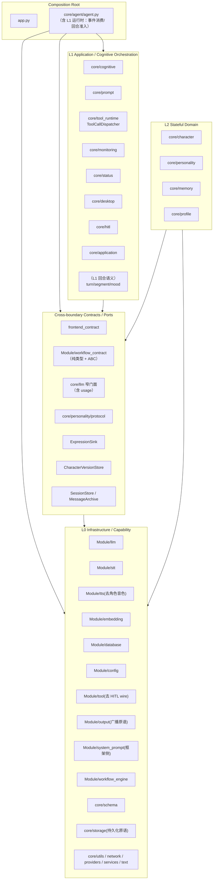
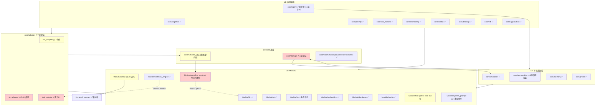
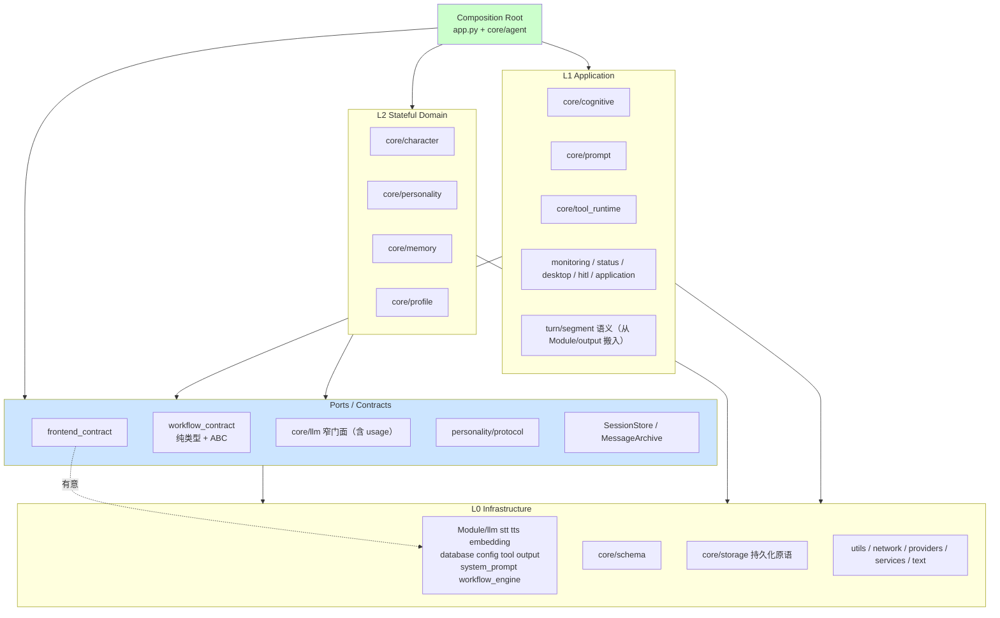
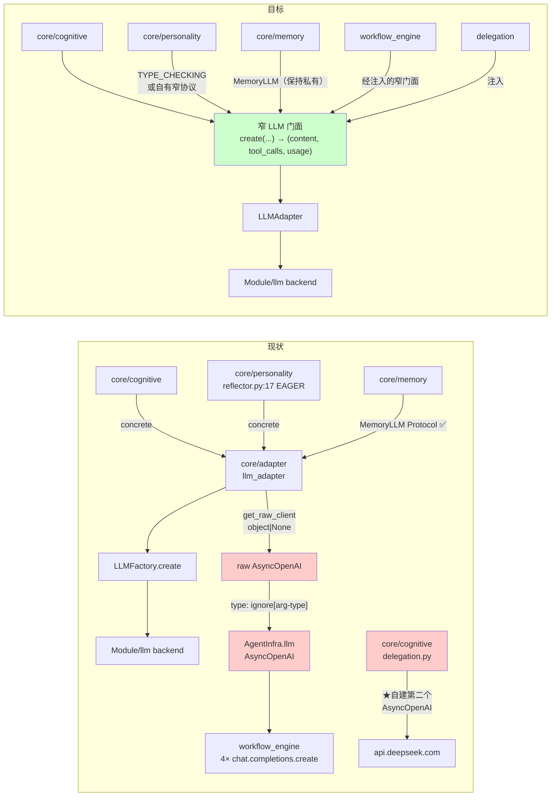
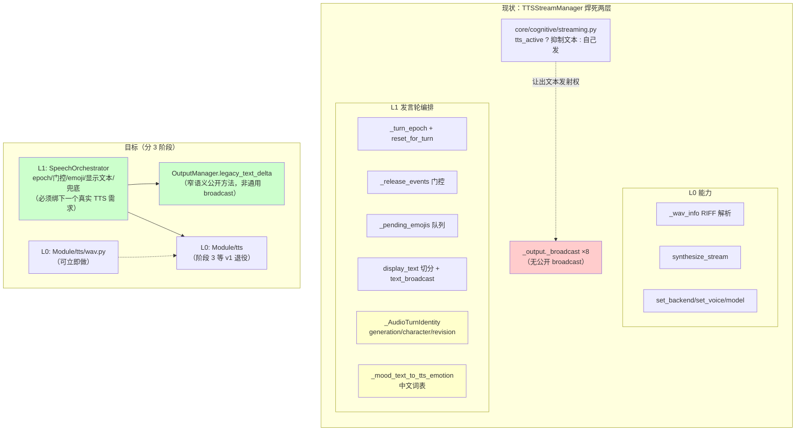
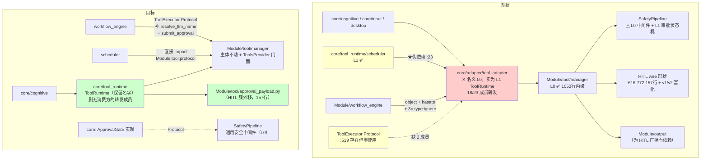
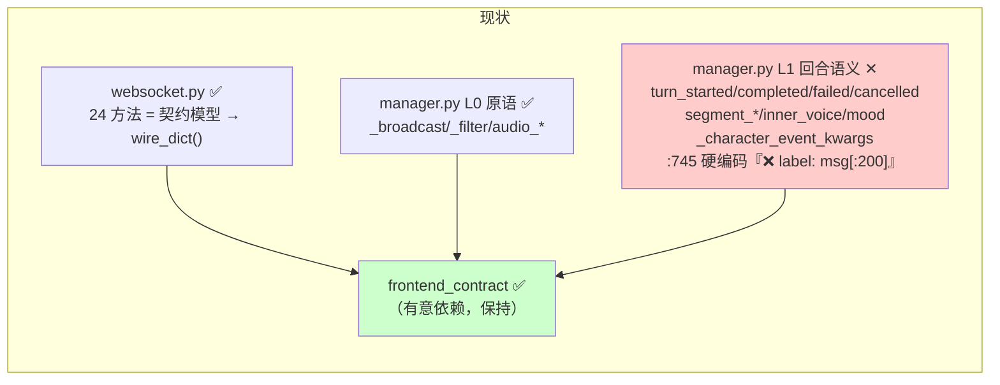

# Elysia Agent 架构职责分离与分层重构审计报告

> 审计范围：`core/`（218 生产文件 / 118,829 行）、`Module/`（141 文件 / 46,470 行）、`frontend_contract/`（18 文件 / 7,442 行）
> 方法：7 个域审计（LLM/IO、Tool、Cognitive/Prompt、Memory/Character、Agent/Lifecycle、Workflow、依赖分析）+ 1 个 Architecture Challenger 反驳 + 主 Agent 逐条独立复核
> 状态：**只做审计与设计，未修改任何生产代码**（`git status` 在 `core/`/`Module/`/`scripts/`/`tests/`/`frontend_contract/` 为空）
> 证据基线：`make check-arch` 全绿（3 条 R1 allowlist）；`make check-contract` 全绿（23 枚举预留 + 4 字段缺口在册）；`pytest --collect-only` = **5,743 条测试**
>
> ⚠️ **落档后修正（Batch 1 执行时实测推翻，2026-09-16）** —— 执行记录见
> `docs/review/2026-09-16-Batch1-correctness-durability-执行记录.md`（§2-C / §2-D、§9）：
>
> 1. **§「缺陷 C」第 420 行的断言是错的。** 本报告写 `AsyncOpenAI(api_key='')` **不报错**
>    （"只有 `None` 抛"），据此把严重度降为 🟠。实测（本机 `openai 2.53.0`）**空串与 `None`
>    都会抛** `OpenAIError: Missing credentials`。含义：**"只删掉手写 guard"并不能修好它，
>    只是把崩溃点往下挪一行** —— 修复方案因此改为"注入 `AgentInfra.llm` + `llm_model`"
>    （Case 2），而不是 Case 1。第 418-420 行的因果链请按此重读。
>    另补：`api_key='sk-…'` + 硬编码 `base_url="https://api.deepseek.com"` 会**构造成功**，
>    即非 DeepSeek 部署被静默错路由；`scripts/setup.sh` 的 `cp .env.example .env` 让占位 key
>    **恒非空**，所以长期可见的症状其实是"错路由"而非"启动失败"。
> 2. **§「缺陷 D」第 892 行的修复理由不成立。** 本报告把价值写成"解耦 CLI/生成器"。
>    实测 `frontend_contract/` 生产代码不导入 `core.*`/`Module.*`，跑真实门禁
>    `python -m frontend_contract --check` 与 `gen_contract_frames.py --check` 时
>    `openai`/`core.schema` 命中数均为 **0** ⇒ 真实受益方是 `core.schema` 导入图的消费者。
>    修复本身成立且已落地（`14778be5`），但**理由与做法都与本报告不同**：不是给
>    `__init__.py` 加懒导出，而是把 `infra.py` 的 SDK 导入收进既有的 `TYPE_CHECKING` 块
>    （`__init__.py` 逐字节不变，公共 API 零风险）；实测 `import core.schema`
>    **1313ms → 537ms**、加载模块数 1284 → 338。
>
> 本报告其余"实测事实"**未逐条重核**。已有一处被推翻，说明引用时应当**现算**而不是转述
> （与 `CLAUDE.md`「断言某个缺陷存在的用例必须把期望值现算」同一条纪律）。

---

# 1. Executive Summary

## 当前架构整体健康

分层**方向**基本成立：全仓 **0 个 eager 模块级 import 环**（375 生产文件 Tarjan 实测）；`Module/workflow_engine/**` 生产代码 **0 处 import `core`**；engine + contract 里 Elysia 专属词（character/personality/mood/inner_voice/user_name）**0 命中**；`frontend_contract/` 零依赖成立。

**没有任何"架构病到必须动手术"的证据。** 本项目处于**高速单作者开发期**（2,266 commits，近 30 天 443 次），任何长周期重构都会与功能交付正面冲突。

## 最大的结构性问题：不是文件太大，而是"层"被当成了目录

真正的系统性缺陷有四类，**没有一类是"文件行数"**：

| # | 问题 | 一句话 |
|---|---|---|
| **S1** | **门禁的假绿** | 三道锁各有盲区：`check_arch` 的 **R5 是死代码**（定义了 `_type_only_edges()` 但 `main()` 从不调用）；隐私守卫**只收字段不收方法**（890 个私有方法在网外，实测漏掉 44 处跨包穿透中的 21 处）；`pyright` 排除 `tests/`；CI 不开放 PR |
| **S2** | **"层"是目录判据的地方，职责不是** | `core/adapter/` 里 `llm_adapter`/`tts_adapter` 是贴近 L0 的包装，`tool_adapter` 是 L1 运行时；`Module/output/manager.py` 里 `websocket.py` 是纯契约形状（健康），`manager.py` 的 turn_*/segment_* 是 L1 回合语义 |
| **S3** | **抽象被绕过，而不是缺失** | 契约层 `AgentInfra.llm: AsyncOpenAI` 直接绑厂商 SDK；`DelegationPreparer` 自建第二个 `AsyncOpenAI`；engine 拿 `object` 硬塞 `tool_registry` 而 `ToolExecutor` Protocol **已存在**；`get_raw_client() -> "object \| None"` 唯一消费点带 `# type: ignore[arg-type]` |
| **S4** | **状态所有权未定义** | 不是"缺 Port"，是"谁拥有这份状态"没写下来：`session.character_state` 未退役却每次 save 都写、`module._tasks` 是多余的第二索引、`TaskResultData` 在中断时被静默丢弃且不可恢复 |

## 明确结论：**值得修，不值得大重构**

- **值得做**：4 个真实缺陷（其中 2 个有用户可感知损害，1 个不可恢复）、门禁假绿修复、纯删减清理。**三批、每批可独立 commit/测试/回滚。**
- **不值得做**：为"层数好看"做的大迁移——5 个候选 Port 里 3 个应降级、1 个应驳回；`ToolAdapter` 改名**收益为负**；`core/storage` 三层拆分收益蒸发；抽 mapper **在依赖图上不可兑现**。
- **最大的一笔"以为已解决"**：S2-H9 的 prompt 预算**只覆盖主生成路径**（`prompt_budget_tokens` 唯一生产者是 `core/cognitive/loop.py:776`）。reflector / consolidator / vision / delegation / workflow_engine 4 处 raw 调用**全部无预算**，"超 context → provider 400 → 该会话永久失败"的风险在 **8 条路径上原样存在**。

---

# 2. Current Architecture（从代码还原，不是 README）

## 2.1 实测子包依赖图

```
Module._common     -> Module.config(2)
Module.bench       -> Module._common, Module.llm, Module.stt, Module.tts, Module.config, core.config(★), core.agent(★)
Module.config      -> Module.embedding(2), Module._common, Module.llm, Module.tts, Module.stt
Module.database    -> Module.config(2), Module._common(2), core.utils(★)
Module.embedding   -> Module._common(2), Module.config(2)
Module.llm         -> Module._common(4), Module.config(2)                 # 零 core
Module.output      -> frontend_contract(4) ★有意, Module._common(3)       # 零 core
Module.stt         -> Module._common(4), Module.config(2)                 # 零 core
Module.system_prompt -> Module._common(1)                                  # 零 core（生产）
Module.tool        -> Module._common(4), Module.output(1)                  # 零 core
Module.tts         -> Module._common(5), Module.config(2)                  # 零 core
Module.workflow_contract -> Module.tool(3)
Module.workflow_engine   -> Module.workflow_contract(42), Module.tool(7), Module._common(1)  # 零 core
core.adapter       -> core.schema(5), Module.tool(4), Module.output(2), Module.llm(1),
                      Module.tts(1), Module._common(1), core.config(1), core.text(1)
core.agent         -> core.storage(39), core.memory(16), core.character(15), core.cognitive(13),
                      core.schema(12), core.monitoring(12), core.adapter(9), core.status(8),
                      Module._common(8), core.config(8), core.debug(8), Module.output(6),
                      Module.tts(6), Module.workflow_engine(6), Module.stt(5),
                      Module.workflow_contract(5), core.personality(4), core.desktop(3),
                      core.profile(3), core.providers(3), core.tool_runtime(3), core.utils(3),
                      Module.embedding(2), Module.config(2), core.hitl(1), core.prompt(1),
                      core.tools(1), core.version(1), core.services(1)
core.character     -> core.storage(14), core.schema(13), frontend_contract(10), core.profile(7),
                      core.memory(3), core.config(2), core.adapter(1), core.prompt(1), core.personality(1)
core.cognitive     -> core.schema(20), core.adapter(11), core.utils(8), core.memory(8),
                      Module.workflow_contract(6), core.character(6), core.status(6),
                      Module.tool(5), core.storage(5), frontend_contract(4), Module.output(4),
                      core.debug(4), core.monitoring(4), core.text(3), core.personality(3),
                      core.profile(3), Module.workflow_engine(3), core.prompt(2),
                      Module.tts(1), Module.system_prompt(1), Module.llm(1)
core.input         -> frontend_contract(47), core.schema(37), core.storage(33), core.agent(18),
                      core.character(12), Module.output(10), core.memory(8), core.providers(8),
                      core.utils(8), core.network(5), core.application(4), Module.stt(3), ...
core.memory        -> core.schema(15), core.storage(10), Module.embedding(3), core.character(2), ...
core.personality   -> core.schema(10), Module.system_prompt(5), core.adapter(4), core.storage(3),
                      core.config(2), Module.output(2), Module._common(2)
core.prompt        -> Module.system_prompt(15), core.schema(4), core.memory(2), core.personality(1),
                      core.cognitive(1), core.character(1), core.config(1), core.profile(1)
core.schema        -> Module.workflow_contract(2) ★反向, Module._common(1)
core.storage       -> core.schema(35), Module.database(16), core.character(4) ★反向,
                      core.agent(2) ★, core.memory(1), core.profile(1), frontend_contract(1)
core.status        -> core.schema(9), core.utils(6), core.adapter(1), core.monitoring(1), Module.output(1)
core.tools         -> Module.tool(24), Module._common(8), core.schema(5), Module.workflow_contract(2), Module.llm(1)
```

**扇入 top（事实上的契约层）**：`core.schema`(181) 全仓第一，其后 `Module._common` / `frontend_contract` / `Module.tool`。

## 2.2 名义层 vs 实际层

| 子包 | 声明层 | 实际层 | 依据 |
|---|---|---|---|
| `Module/llm`、`Module/stt`、`Module/embedding` | L0 | **L0** ✅ | Business Semantic Test 通过；零 core |
| `Module/tts` | L0 | **L0 + 3 处 L2 污染** △ | `minimax_tts.py:100 voice_id="elysia_test_001"` + `voice_map` + `protocol.py:84 default_voice(character)` |
| `Module/output/websocket.py` | L0 | **L0** ✅ | 24 个方法全是 `契约模型(...).wire_dict()` |
| `Module/output/manager.py` | L0 | **L0 原语 + L1 回合语义** △ | `:569-782` 的 `turn_started/turn_completed/turn_failed/inner_voice/mood` + `_character_event_kwargs` + `:745` 硬编码 `"❌ {label}: {msg[:200]}"` |
| `Module/tool/manager.py` | L0 | **L0 + 157 行 L1 wire 形状** △ | `:616-772` HITL v1/v2 payload 富化 + `:639` `getattr(output_manager,"_split_versions")` |
| `Module/tool/safety.py` | L0 | **L0 中间件 + L1 审批状态机** △ | `:398-400` `_hitl_requests/_hitl_timeout=60`、`:407-440` 连接归属校验、`:372-384` 读 `services["_origin_connection_id"]`（**只有 core 写**） |
| `Module/workflow_contract` | 契约层 | **纯类型 + 一个 SDK 后门容器** △ | `schema.py` 干净；`infra.py:17 from openai import AsyncOpenAI` + `:51 llm: AsyncOpenAI` |
| `core/adapter/llm_adapter` `tts_adapter` | L1 | **贴近 L0 的包装** | 见 §5.1 / §5.2 |
| `core/adapter/tool_adapter` | L0 包装器 | **L1 Agent ToolRuntime** ✕ | 见 §5.3 |
| `core/schema` | L0 共享类型 | **L0 但反向依赖契约层** △ | `types.py:7`、`event.py:13`；且实测 `import core.schema.types` 会拉起 `openai`+`httpx` |
| `core/storage` | L0 持久化 | **三层混装**（L0 21 / L1 4 / L2 2）✕ | `desktop_call_repo.py:113-137` 九态状态机；`attachment_gc.py` 441 行运维策略 |
| `core/status`、`core/monitoring` | L1 | **L1** ✅ | 不该为形式而拆 |
| `core/application` | L1 用例层 | **L1** ✅ | 名副其实，规模小是设计约束 |
| `core/hitl.py` | ? | **L1 装配胶水** ✅（但功能未接通） | 依赖方向正确：core 实现 Module 的 ABC |

## 2.3 环形依赖

- **eager 模块级环：0**（独立复核 R4 成立）
- **eager 子包级环**：`core.character ⇄ core.storage ⇄ core.profile`（真）；
  `Module._common ⇄ Module.config` **是伪环**（一条来自 `_common/config_test_helpers.py:10` 测试辅助、一条来自 `config/__main__.py:8` CLI 入口，**无一条是库代码边**）
- **含 lazy 边的环：4**，**含 type 边的环：9**（R4 只算 eager，全看不见）
- **lazy 环边 100% 有显式循环说明**（逐条核对结论：这一项项目做得比自述还好）

---

# 3. Dependency Findings

## 3.1 跨层 / 反向依赖（8 条两假设下都成立的硬违规）

| 源(file:line) | 目标 | 桶 | 问题 |
|---|---|---|---|
| `Module/bench/bench.py:130,140` | `core.config` / `core.agent` | lazy | R1 allowlist（已知） |
| `Module/database/documentdb/__main__.py:40` | `core.utils` | lazy | R1 allowlist（已知） |
| `core/debug/info.py:20` | `core.agent` | type | L2→组合根 |
| `core/services/capabilities.py:23,24` | `core.agent` / `core.agent.server` | type | **真掩盖**：`core/agent/server.py:11` 是 **eager** 反向 ⇒ 运行时方向 agent→services，类型方向 services→agent |
| `core/storage/attachment_release.py:34` | `core.agent` | type | L2→组合根 |
| `core/storage/pending_attachment_release.py:35` | `core.agent` | type | L2→组合根 |

**全仓唯一一条 core 内 eager 向上边**：`core/personality/reflector.py:17 from core.adapter.llm_adapter import LLMAdapter`。
（注：`core.adapter` 零 core 领域出边，层归属本身有歧义——按依赖深度可判 L2 peer。**两种口径下这条都是唯一 eager 边**。）

**`core.storage → core.character`（4 条 eager）的讽刺点**：团队明确知道这是反向依赖并在**一处**刻意规避——
`core/storage/character_revision_repo.py:113` 注释：*"裸抛原始 DuplicateKeyError——storage 层不 import domain 异常（那会造成 storage→character 反向依赖）"*——而**同包的另外 4 个文件正在 eager 地这么做**。规则写在注释里，没有写进门禁。

**`core.storage ⇄ core.character` 被门禁结构性豁免**：`scripts/check_architecture.py:12,111` 把 `core.storage` 与 `core.character` **并列**列为"领域/基础设施层"，R2 只禁它们依赖 `core.input`，R4 只算模块级环 ⇒ 这条边永远不会报。

## 3.2 `TYPE_CHECKING` 掩盖架构依赖

222 条跨子包 type 边中 10 条方向向上，**7 条参与环，2 条是真掩盖**（上表 `core/services/capabilities.py:24` 与 `core/storage/memory_repo.py:11`）。**其余 215 条（97%）是正常标注** —— 这一项项目做得比自述好。

## 3.3 抽象泄漏（raw client / concrete injection）

**最完整的泄漏链**（全链实测）：

```
Module/llm/protocol.py:83            raw_client  (ABC 成员)
  → openai_compat.py:299             return self._client
  → core/adapter/llm_adapter.py:216  get_raw_client() -> "object | None"
  → core/agent/_lifecycle_task_system.py:183  llm=self._llm.get_raw_client(),  # type: ignore[arg-type]
  → Module/workflow_contract/infra.py:51      llm: AsyncOpenAI      ★契约声明具体 SDK
  → 4 处直接调用：
      workflow_engine/core/planner/parser.py:58
      workflow_engine/core/executor.py:391, 486
      workflow_engine/core/evaluator.py:265
```

三个问题叠加：① 契约允许 `None` 而消费方**零 None 检查**；② `# type: ignore[arg-type]` 是形状不匹配的自白；③ 契约层顶层 `from openai import AsyncOpenAI`。

**第二条独立 raw client**：`core/cognitive/delegation.py:125-128` 自建 `AsyncOpenAI(api_key=os.environ["DEEPSEEK_API_KEY"], base_url="https://api.deepseek.com")`，与 `LLMAdapter` 切模型完全脱钩。

## 3.4 私有穿透（两道守卫的实测覆盖）

`python -m pytest core/tests/test_cross_package_privacy.py core/input/tests/test_layer_discipline.py -q` → **4 passed**（全绿）。

独立扫描（带宿主类型推断）：**185 访问点 / 44 可证跨包 / 16 未标注** ⇒ **守卫抓 23 漏 21（48% 漏报率）**。

**根因三条**：
1. `test_cross_package_privacy.py:101-118 _private_attr_defs()` **只收 `Assign`/`AnnAssign`，不收 `FunctionDef`** ⇒ 私有**方法**永不进归属表 ⇒ `:148 if defining and all(...)` 因**空集短路恒放过**。（实测 **890 个私有方法**在网外；`test_guard_is_not_vacuous` 的合成探针只用字段，测不到这一类。）
2. 同名属性消歧失败（`core/prompt/prompt_assembler.py:219,220,221` 写 `self._emotion_section._session`，因 `core/prompt` 自己也有 `_session` 被全放过）。
3. `Module/` 被当成单一包（`Module/tool/manager.py:639 → Module/output._split_versions` 直接穿网）。

**9 处未标注同源** = `self._output._broadcast(...)`（`tts_adapter.py` 8 处 + `streaming.py:243`）。代码自己承认接口缺口——`core/cognitive/finalize.py:368`：*"OutputManager 只有私有 `_broadcast`（无公开 broadcast）"*。

## 3.5 重复 state ownership

| 状态 | 权威 | 副本/残留 | 判定 |
|---|---|---|---|
| `session.character_state` | **无人拥有** | `session.py:102` 每会话 eager 建；`:312/:348` **每次 save 都写 stale 快照**；`:432-444/:483-485` 读回 | ✕ 死字段白写 |
| `CharacterRuntimeState` | `runtime.state` | `engine.state` 同引用 ✅；`instance.state` 别名但有窗口期 | ◐ |
| `LongTermMemory._entries` | **分裂**：Milvus 是向量权威，`_entries` 是候选集唯一来源（`:115-122` 按 `_milvus_pk` 回连） | Milvus 有行而内存没有 = **静默丢弃** | △ |
| `stateVersion` | `instance.stateVersion` | 仅 3 同步点（`runtime.py:63`/`instances.py:76-78`/`agent.py:592`），分叉即 409 | △ |
| generation identity | loop 单槽 `_generation_ctx` | + 2 内存终态标志 + Mongo 行 + TTS `_AudioTurnIdentity`（复制 5 字段，含 3 个 TTS 不用的角色审计字段）+ **与 generation_id 同构的第二套 `_turn_epoch`** | ✕ 6 处 |
| desktop availability | `bridge._connected` | `ToolManager._desktop_available` 缓存（`manager.py:87/506`）⇒ `definitions()` 读实时、`plugin_list` 读缓存 ⇒ **同一回合内可自相矛盾** | ✕ 2 份 |
| 审批 pending | **两个域**：工具域 `SafetyPipeline._hitl_requests` vs workflow 域 `EventBusHITLNotifier`+`ApprovalId` | `core/hitl.py:36-37` 自述"回传路由到错误的审批域，恒不命中" | ✕ |
| 后台任务终态 | mailbox deque + WAL + Mongo（三份表征） | **无单一所有者**：`delivered` 由生产者写、消费者从不确认 | △ |
| `RunState`/`AgentState` | 单一持有者 ✅ | — | ✅ |
| `UserIdentity._cached` | Mongo | 纯读缓存，写入路径单一 | ✅ |
| `SessionMemory._messages` | deque | 4 份但分工明确 + 去重 | ✅ |

**死状态（实测 0 读取，可直接删）**：`_mongo_available`/`_milvus_available`（仅 `_lifecycle_persistence.py:514,516` 两处写 + Protocol 声明）、`CharacterRuntime.dirty`（零生产消费者，LRU 只看 `_busy`）、`_tool_names`（`tool_adapter.py:111` 只写不读）、`web_search`/`brave_api_key`（`web/plugin.py:141,143` 只读不写 = 死分支）、`AgentInfra.background_task_results`（注入后 engine 从未使用）、`AgentInfra.milvus`/`http`（生产恒 `None`）。

---

# 4. Responsibility Separation Candidates

| Module | Current | Problem | Recommendation | Priority |
|---|---|---|---|---|
| `core/cognitive/delegation.py` | L1 委派准备器 | `__init__` 自建 `AsyncOpenAI` + 读 `DEEPSEEK_API_KEY` + 缺失即 `raise`；**排在 `_STARTUP_STEPS` 上** | **修缺陷**：改为注入 LLM | **HIGH** |
| `Module/system_prompt/system_prompt_manager.py` | L0 渲染器 | 截断梯子 `set_context(memory_limit=)` 清空所有 section 的 per-request 上下文；`_memory_limit` 无复位 | **修缺陷**（捕获→恢复→复位） | **HIGH** |
| 后台任务终态投递 | L1 | `delivered=True` 写在 `bus.post` 前 + WAL 同刻删；中断排空总线丢弃 `TaskResultData` | **修缺陷**（中断时保留 TaskResultData） | **HIGH** |
| `Module/tool/manager.py:616-772`（157 行 HITL 簇） | L0 | v1/v2 前端 payload 富化 + 产品文案住 L0 | **Split**：外移 `Module/tool/approval_payload.py`（只依赖 `_plugins.get()`，与锁/原子替换无关） | MEDIUM |
| `Module/output/manager.py:569-782` | L0 | `turn_*`/`segment_*`/`inner_voice`/`mood` + `_character_event_kwargs` + 硬编码 v1 文案 = L1 回合语义 | **Move**（必须真搬，不得留转发 wrapper） | MEDIUM |
| `Module/workflow_contract/infra.py` | 契约层 | `llm: AsyncOpenAI`（SDK 类型）+ `tool_registry: object` + `orphan_tools: set[Task]`（可变运行时状态住契约层）+ 3 个死字段 | **只加 Protocol**（窄 LLM 门面含 `usage`；`tool_registry` 用 `ToolExecutor` 扩 2 成员） | MEDIUM |
| `core/adapter/tool_adapter.py` | "L0 包装器" | 实为 **L1 Agent ToolRuntime**；18/23 成员转发 `ToolManager` | **不改名**。替代：审计并**删掉无消费方的转发成员**（真收益），保留名字 | MEDIUM |
| `Module/tool/safety.py:372-440,765-803` | L0 中间件 | HITL 审批状态机（`_hitl_requests` / 连接归属 / 60s 阻塞） | **只加 Protocol**：`ApprovalGate`，Elysia 实现留 core | MEDIUM |
| `Module/tts/minimax_tts.py:100,281-315` | L0 | 角色音色映射（`elysia_test_001` + `voice_map` + `default_voice(character)`，~20 行） | **Move** 到 core 侧 | LOW |
| `core/memory/session.py:84,102,312,348,432-444,483-485` | L2 | `character_state` 死字段白写（`CharacterState` 与 `CharacterRuntimeState` 字段同构） | **删字段**（撞 **11** 个测试文件；**必须排在缺陷 2 修复之后**） | LOW |
| `Module/tool/manager.py` `_tasks` 第二索引 | L0 | P2-03 已改用 `_inflight` 兜底却没删；生产唯一读者 `cancel_all:567-569` | **删索引** | LOW |
| `core/tool_runtime/scheduler.py:23` | L1 | `from core.adapter import ToolContext,...` **伪依赖**（那 3 个名字只是 `Module.tool.protocol` 重导出） | **改 import** | LOW |
| `core/agent/server.py:734 run_repl` | L1 | 死代码（全仓 3 处命中 = 2 docstring + 定义） | **删** | LOW |
| `core/personality/protocol.py:241` | 契约层 | 成员类型指向具体仓储 `CharacterVersionRepository` | **只加 Protocol**（`CharacterVersionStore`，4 方法） | LOW |
| `core/memory/session.py:36-38` + `session_manager.py:34-40` | L2 | 依赖具体 repo；**但有真实测试替身**（`FakeSessionRepo`/`FakeMsgRepo` 被 `test_session_cascade.py` 复用） | **Port**（5 个候选中唯一有真 fake 打底） | LOW |
| `core/storage/` | L0 持久化 | 三层混装（L1 4 个 / L2 2 个） | **降级为可选**（见 §6） | LOW |

---

# 5. Detailed Analysis

## 5.1 `core/adapter/llm_adapter.py`（231 行）

**当前层**：L1（目录在 `core/adapter/`，但内容 90% 是 L0 内核）

**逐职责判定**：

| 职责 | 行 | 层 | 理由 |
|---|---|---|---|
| `LLMFactory.create()` | 57, 202 | **L0** | 后端构造 |
| `close()` / 后端生命周期 | 175-186 | **L0** | 连接池管理 |
| `reconnect()` | 188-193 | **L0** | `getattr(self._backend,'reconnect',None)` —— **`LLMBackend` ABC 漏了该成员** |
| retry/backoff（`_RETRYABLE_STATUS`/`_MAX_RETRIES`/`_RETRY_BACKOFF_BASE`/`_extract_status`） | 22-24, 128-173 | **L0** | 与 Elysia 无关 |
| `switch_model()` + `AsyncTaskScope` 旧后端关闭 | 195-210 | **L0** | 但"当前模型"是**服务运行时状态** |
| `think()` + `ThoughtResult` + `normalize_tool_calls` | 27-91 | **L1** | `ThoughtResult.tool_calls: list[ToolCall]` 是 core 类型 |
| `stream_think()` | 105-153 | **L1 薄壳** | 工具模式 + 重试语义 |
| `get_raw_client()` | 216-231 | **泄漏** | 见 §3.3 |

**结论：`Move → Module/llm/` 不可行，也不必要。**
- **不可行**：硬阻塞是 `llm_adapter.py:30/81` 的 `ThoughtResult.tool_calls: list[ToolCall]`。`ToolCall`（`core/schema/tool.py`，65 行）唯一依赖 `ToolCallId = NewType(...)`（**纯 stdlib，零依赖**），且**下沉范式已有先例**：`SessionId` 由 `Module/workflow_contract/schema.py:39` 拥有、`core/schema/types.py:5` 反向 import 重导出。
- **不必要**：`Module/llm` 的 L0 契约**早就是 raw dict**（`openai_compat.py:211-226` 吐 `{"index","id","type","function":{...}}`；`protocol.py:59-73` 明文约定）。"Module 只吐 raw dict"不是待设计的方案，是**已落地的现状**。为纯类型付 34 个文件引用的代价 = 为对称而重构。

**真正该修的（不是分层）**：
1. `reconnect()` 应从 ABC 之外收进来（`Module/llm/protocol.py` 补默认实现），消掉 `getattr` 探测。
2. `_requested_model`（`llm_adapter.py:48,214`）与 `session.service_state.llm_model`（`server.py:366`）是**同一状态两份副本**——`tts_adapter.py:341-359` 的 docstring 自己承认"活动会话的 `service_state` 与真正在用的后端**可以分叉**"。这是真 state-ownership 问题。

## 5.2 `core/adapter/tts_adapter.py`（586 行，`TTSStreamManager`）

**当前层**：L1 与 L0 **焊在一个类里**。

**L0 部分（应留在 TTS 能力层）**：`_wav_info`（`:58-82`，RIFF chunk 遍历，不假设 44 字节头）、chunk 流、`synthesize` 调用、`set_backend`、`set_voice`、`model`/`active`/`enabled`/`set_enabled`。

**L1 部分（Agent 发言轮编排）**：
- **turn epoch**：`_turn_epoch`（`:149`）+ `reset_for_turn`（`:153-175`）+ `_release_gate`（`:177-190`）
- **emoji 与句子同步**：`_pending_emojis` + `flush_emojis`（`:247-260`）
- **gated playback**：`_release_events: dict[int, asyncio.Event]`
- **"用户是否该看到文本"**：`display_text` vs TTS 文本切分（`:218-223, 448`）+ `text_broadcast` 防双播（`:450-451, 501, 529-542`）
- **L2 语义穿透**：`_AudioTurnIdentity`（`:85-103`）复制 conversation/generation/character_id/instance_id/revision；`_mood_text_to_tts_emotion`（`:37-53`）中文情绪词表
- **OutputManager 耦合**：`_output._broadcast(...)` ×8

**关键发现（推翻了"职责错配"假设）**：这**不是**"TTS 越权发文本"，而是 **L1 主动把文本让给 TTS**：
- `core/cognitive/streaming.py:213` `tts_active = self._tts_mgr.active and self._tts_mgr.enabled`；`:240 if not tts_active: await self._output.text_delta(...)`
- `tts_adapter.py:486/494/502` 在 `await gate.wait()` 之后发文本，带 `stream_id=sid` —— **这是"文字跟着音频出现"的实现**
- `websocket.py:144 on_text_delta` **无版本门控**；`capabilities`（`:82-91`）对 v1/v2 返回同一集合且含 `TEXT_DELTA`

⇒ **`_broadcast` 的 9 处不能简单搬到 L1，那会把音画同步做坏。** 真问题是"缺一个封装 v1 wire 形状的窄公开方法"。

**建议切分线（不是"TTS IO vs 其余"）**：**L0 = 一句话 → 音频**；**L1 = 一个发言轮**（epoch / 门控 / emoji / 显示文本 / enabled 兜底）。
- 阶段 1（可做）：`_wav_info` → `Module/tts/wav.py`
- 阶段 2（**必须绑下一个真实 TTS 需求**）：抽出 `SpeechOrchestrator`
- 阶段 3（等 v1 退役白拿）

## 5.3 `core/adapter/tool_adapter.py`（370 行，`ToolAdapter`）

**当前层**：名义 L0 包装器，**实质 L1 Agent ToolRuntime**。

**六条证据**：
1. **per-turn session 绑定宿主**：`tool_context`（`:133-140`）返回**同一个 mutable 对象**；L1 每回合换绑 `svc["session"]`/`["memory"]`/`["_session_msg_count"]`/`["_origin_connection_id"]`（`loop.py:527-535`），每调用刷新 `["_fsm_state"]`（`tools.py:86-90`）
2. **拥有 desktop availability**：`set_desktop_available`（`:325-331`）+ `definitions()` 的 D-j 过滤（`:186-190`）
3. **HITL 应用行为公开门面**：`submit_approval`（`:204-224`，docstring 自述是为消除 input 层 `agent.tool_adapter._manager` 穿透）、`get_pending_approvals`、`build_approval_payload`
4. **被 Module 鸭子类型调用**：`_lifecycle_task_system.py:186 tool_registry=self._tool_adapter` → `workflow_engine/lifecycle.py:229 hasattr(...)` + `executor.py:359,433,541` 三个 `# type: ignore[attr-defined]`
5. wire 呈现：`runtime_for`（`:248-258`）
6. L1 策略数据唯一来源：`declared_request_timeout`（`:270-272`）/`declares_idempotent`（`:274-280`）供 `scheduler._timeout_for` 与重试门控

**反对证据**：**18/23 成员是转发 `self._manager`**（其中 11 个集中在 `:260-370` 的"管理门面（批次 A / ARCH-INC-P2-04）"段，那段有明确注释说明"先补门面，内部拆分暂缓"）。

**结论：不改名（改名收益为负）。** 名字叫 `Adapter` **恰好准确描述那 18 个转发成员**；改名 `ToolRuntime` 会让人以为那 18 个成员是"runtime 的能力"，而它们只是 `ToolManager` 的透传——**把一次已决策的门面叙事成领域对象**。

**拆成 L0 wrapper + L1 runtime 也不对**：会造出 `消费方 → runtime → wrapper → ToolManager` 第三层，而 `ToolManager` **已经**是 L0 wrapper。

**替代建议（真收益）**：审计那 18 个转发成员"是否被 `core` 之外消费"，只保留实际被消费的（预计可砍掉一半），其余消费方直接依赖 `ToolManager`。**这一步比改名更接近"揭示真相"，而且能删代码。**

## 5.4 `core/tool_runtime/scheduler.py`（803 行）vs `Module/tool/manager.py`（1052 行）

**两套任务所有权并存，且并存是合理的**：

| | `Module/tool/manager.py` | `core/tool_runtime/scheduler.py` |
|---|---|---|
| 状态 | `_tasks: dict[str, Task]` + `_inflight: dict[str, set[Task]]` + `_teardown_tasks` | `_tasks: dict[TaskId, QueuedToolCall]` + `_workers: list[Task]` |
| 单位 | 插件**实例**级（reload 排空 / shutdown drain） | **回合**级（优先级 / 重试 / 预算 / 有界等待） |
| 变化原因 | 插件生命周期 | turn 编排策略 |

**⇒ 两条不同的 reason-to-change 轴，不该合。**

**但 `_tasks` 是遗留的第二索引**：P2-03 发现 key 撞车改用 `_inflight` 兜底却没回头删。生产唯一读者是 `cancel_all:567-569`，而 `_inflight_all()` 是超集。
**⇒ 删 `_tasks`（LOW 风险 / 真实收益）**：把现在只写在注释里的取消不变量变成机制。

## 5.5 `core/cognitive/loop.py`（1254 行，`CognitiveLoop`）

**结论：不按行数拆。** 逐职责分类（16 行）：

| 类别 | 是否同一变化原因 |
|---|---|
| ReAct 编排 / prompt 构建 / FSM 驱动 / 中断处理 | ✅ 同因（≈60%） |
| **#13 desktop offline 规则**（`loop.py:40 STATUS_OFFLINE` + `_cancel_desktop_calls:1182-1207`，把 "offline≠cancelled" 领域规则写进 loop） | ❌ 不同因，**可分离，收益/风险比最好** |
| #5 generation 终态登记 | ❌ 不同因 |
| #8+#14 after-response 记忆/性格沉淀 | ❌ 不同因，但**风险 HIGH 不建议本轮做**（`finalize.py:251-265` 的先放 lease 再跑去重是 S3-15 刚修的 409 缺陷） |
| TTS 协调 | ❌ 不同因，**但不该分离**（耦合已被 `TTSStreamManager` 收敛） |
| character runtime 绑定与 lease | ❌ 不同因，**但不该分离**（必须与回合同生命周期） |

**mixin 边界（streaming/finalize/tool_phase）**：拆分**按行数切的**，不是按变化原因——拆分提交自证动机是"拆高复杂度枢纽函数"；拆分后 42 次涉及该域的提交里 **11 次同时改 ≥2 文件**（`finalize+loop` 10 次）。**唯独 `tool_phase.py` 只动过 1 次，那个边界是真的。**
**但结论是不返工**：三者仍在一个类里，无跨模块边界，害处只是导航成本。

**mixin 的隐式耦合已受控**：3 个跨 mixin 调用（`_turn_character_snapshot`/`_after_response`/`_transition_idle`）都已显式声明为 `Callable`。真缺陷是 `_session` 只在 `_prepare_turn` 赋值却声明为非 Optional（会 `AttributeError` 而非清晰报错）。

## 5.6 Prompt 分层

**`Module/system_prompt` 框架侧属 L0 且健康**：生产代码零 core 依赖（仅 `__main__.py:4` 依赖 `Module._common`）；`PromptSection`/`Jinja2Section`/`escape_template_vars`/`Trusted`/`budget.py` 可独立复用。**`Trusted` 转义机制属 L0 且待对了**（唯一渲染点递归转义所有字符串叶子 + 显式豁免）。

**但 `SystemPromptManager` 是 L1 策略住在 L0 目录**：`_RENDER_ORDER` 12 个 Elysia section 名 + `_DROPPABLE`/`_PROTECTED` 业务优先级 + 直接知道 C4 的 `memory_limit` 语义。**建议记录，不建议搬**（搬迁无实际收益）。

**12 个 section 没有被迫知道 domain**（session/long_term 一律 `Any` duck-typing），代价是类型安全为零 + 装配靠写私有字段。

**`core/prompt` ↔ `Module.system_prompt` 的 15 处依赖本身健康**（12 个 section 各 1 行 = 注册清单）。真问题是 `prompt_assembler.py:219-221` **core 写 Module 对象私有字段 `_session` ×3 且无 noqa**，守卫**实测漏报**。

## 5.7 Memory / Character / Profile

**核心命题成立**：13 个 `*_repo.py` **无一条记忆/角色领域不变量**。两条关键业务规则都不在 storage——归档改写 `defaultCharacterId` 在 `core/character/service/instances.py:355-378`；级联删除清单在 `agent.py:224-235`（装配）+ `session_manager.py:685-703`（执行）。
**⇒ `MemoryRepository`/`CharacterRepository` 不应因为服务 Memory 就自动属于 L2。** `memory_repo.py` 是 **adapter**（5 方法全是 `self._db.*` 转发）。

**`core/personality` = L2 状态机 + L1 副作用编排混装**（`emotion.py:160-182` 推表情、`awareness.py:102` 后台上 LLM、`engine.py:482` create_task）。**不建议拆包**（拆只有"引事件总线"或"大爆炸"两条路）。

**`core/personality/protocol.py` 的做法从未被验证**：全仓 `class .*CharacterEngineProtocol` = **0 命中**——没有任何第二实现。被行使的收益只有"消费方类型注解不依赖具体类"，**"引擎可替换"这一条动机从未被任何测试行使过**。
⇒ **protocol.py 本身不动，但"推广"的门槛要加一条：必须有第二实现或有明确的替换计划。**

**`core/character` 的"三层模型"名不副实**：Definition 是可变指针、Revision 是唯一汇合点、Instance 持指针+CAS+状态本体 ⇒ 真三层是**内容/状态/运行时**。领域不变式**不在 `integrity.py`**（它只是只读告警），散落 8 处。

**`registry` 是 L1 生命周期**（LRU / `AsyncTaskScope` / 3s drain 都属生命周期关切，非领域）。4 处 `_runtimes` noqa 全判"缺公开 API"：registry 已有 `get_existing`（`:84-89`）只缺批量版 ⇒ **3 行 `iter_runtimes()` 清 6 处 noqa**。

**`core/profile` = L2 领域服务 + L0 读缓存**。`_cached` **不是第二权威**（写入路径单一）。`update_if_revision` 的 CAS **机制是 persistence**、**策略是 domain**（白名单 / "revision 从 1 起" / 冲突→409 / 权威不可用 fail-closed）。
**真缺陷**：`UPDATABLE_FIELDS` 两份（`user_identity_repo.py:40-43` ↔ `profile_store.py:193-196`），**repo 那份才真正生效**，而它对未知键**静默 continue**（`:158-161`）⇒ 只改 store 会**静默丢更新**。

**`core/application` 名副其实，不是空壳**：`sessions.py` 消除了"激活会话"在 WS/REST 两处各写一遍且判定顺序不同导致错误码不同的真缺陷；`attachment_signing.py` 是零 aiohttp 的安全边界。规模小是**设计约束**，**不要扩**。

## 5.8 Agent / Lifecycle

**`Agent` 不是纯组合根，但也不是腐化的组合根**——它是「Composition Root + 一个未被命名的 L1 运行时（事件消费 / 回合准入排队重放 / 生命周期状态机）」共处一类。

行数分布：`__init__` 129-549（**420 行**，真装配）/ 46 个 `@property` 1034-1399（**366 行**，32 薄 getter + 14 计算）/ `process_message` 599-703（105）/ **事件消费块 759-1033（275 行 = 真 L1 业务逻辑）**。

**"大"成立（组合根本职），"只有装配"不成立。** 但那 275 行**不该抽**——需 9 个 `self` 属性 + 紧耦合状态机，抽出必然更糟；**它跨的是"名义"不是"层"**。
（零成本选项：`Agent` 已用 mixin 组织，把事件消费块做成 `AgentEventConsumer` mixin 可降到 ~1120 行，且 `core/tests/test_event_dispatch_else.py` 已单独测这块的分派边界。**归入纯删减批次，不新开批次。**）

**lifecycle 含三个不同变化原因**（resource ≈17 步 / orchestration ≈9 步 / **domain recovery ≈11 步**，后者是唯一持续增长项），**但不要拆层**（被顺序强耦合）。`_STARTUP_STEPS`/`_SHUTDOWN_STEPS` **已真正解决顺序问题**（数据驱动 + 偏序断言 `test_lifecycle_steps.py` + 20 步×3 失败类全矩阵 + 假绿守卫）。

**26 处 `getattr(self,"_xxx",None)`（`_lifecycle_persistence.py`）是「测试替身驱动」的防御性编码，不是"重启后属性可能不存在"**：`run_agent_service` 每轮新建 Agent 实例、`__init__` 必跑；被守卫的 11 个属性**全部在 `__init__` 无条件赋值**；3 个测试直接 `_LifecyclePersistence()` 无 `__init__` 实例化。
**真正有害的副作用**：契约破裂 → **静默降级**（`_bg_result_repo()` 返回 None 即"跨重启保障静默失效"），启动日志全绿。

**`core/status` 整体 L1，不该为形式而拆**。ABC vs `typing.Protocol` 的不一致是**刻意且已文档化**的（`core/personality/protocol.py:1-40` 点名解释）。`agent_fsm` 不暴露、只给语义查询是**本域最好的设计**（外部 0 处读 `agent._fsm`）。`fsm.py:18` 的 `TTSStreamManager` 是窄型具体类依赖，**可接受**（"SPEAKING 结束 = TTS 播完"本就属相位语义；无环）。

**`core/monitoring` 三者并列而非纠缠**（改 A 不需动 B/C），同包零跨层耦合，**保持 L1**。
⚠️ **`TokenTracker` 做成本估算的前提是错的**：全仓 `cost|price|pricing|usd|成本` 在 `core/monitoring/` + `core/schema/token.py` **0 命中**。

**`core/agent/server.py` 与 `core/input/server.py` 边界清晰、零职责重叠**（前者独占进程/传输宿主，后者独占路由/中间件/REST）。两处越界：`run_repl` 死代码；`switch_*`/`set_service`（≈150 行）是运行时能力切换而非 server 行为，且与 `run_server:596-635` 的 STT 引导是同一套逻辑两份实现。

## 5.9 Workflow / Background

**形状健康**（0 eager 环 / engine 生产代码 0 处 import core / Elysia 专属词 0 命中 / Business Semantic Test 通过），**实质有三处破口**（见 §3.3 与 §4）。

**`Module.workflow_contract -> Module.tool`（2 处）** = `Tool` 描述符 + `RBACLevel`，用于 `DelegationContext.tools` 与 `HITLData.rbac_level`。
**不引入环**（实测证明），是"语义下沉"而非"环"。副作用：`workflow_contract/__init__.py:32` eager 导入 `AgentInfra` ⇒ **导入纯类型模块会拉起 openai + httpx**（实测 `import core.schema.types` 后 `openai`/`httpx` 已在 `sys.modules`）。

**`core.schema -> Module.workflow_contract`（2 处）** = `SessionId` + `WorkflowId`。方向不对（core 的地基依赖跨边契约层），但**代价仅 2 个 NewType 且无环**。旁证：`SessionId` 是 `core/schema/types.py` 里唯一不在 core 内定义的 ID NewType。

**`AgentInfra` 9 个字段只有 2 个形态正确**（`constraints` / `terminal_result_sink`）。`milvus`/`http`/`background_task_results` 是死字段（最后一个注入后 engine 从未使用，契约层却为它写了 7 行文档）；`orphan_tools: set[asyncio.Task]` **错层**（契约层持有可变运行时状态）。

**契约门禁卫生**：`_RESERVED_ENUM_MEMBERS` **23/23 都带「解除条件」**（CLAUDE.md 说法为真）；但 `_PENDING_WRITERS` **0/4 带**且门禁按构造跳过它（`check_contract_reachability.py:359`）。132 枚举成员 82.6% 可达，208 字段 98.1% 干净。
**⇒ "契约层设计过度超前"是误判，"引擎 schema 超前"才对**（19/23 预留成员在 `workflow_engine/schema`）。
**门禁今天 exit 0 却载着 2 条陈旧登记**（`CANCELLED_BY_USER` 已被 `internal.py:156` 真实生产、`token_entries` 经 `token_ledger.py:70` 变异写入）——判据看不见"契约模块方法体内的写入"与"经 append 的写入"，且把注释里的字段名算作读。

**`debug_api.py`（431 行）**：快照采集/diff **属引擎自观测能力（可接受）**；aiohttp handler + SSE 帧协议 **属应用层下沉**。**性质是"文件放错包"，比"引擎耦合 web 框架"轻**（隔离实测：`import Module.workflow_engine.workflow_engine` 后 aiohttp **不在** `sys.modules`）。**建议仅移动。**

## 5.10 四个真实缺陷（全部经主 Agent 独立复核）

### 缺陷 A 🔴 `SystemPromptManager` 截断污染上下文且不可恢复
**来源**：commit `076ebee8`（2026-09-16 18:26:59，S2-H9）——**审计开始前 1 小时的回归**。
**机制**（执行探针 `tmp/arch_audit/_verify_budget_leak.py` 复现）：
1. `system_prompt_manager.py:94` 截断梯子调 `self.set_context(memory_limit=limit)`——**只传这一个 key**
2. `:135` 广播给**所有** section；10 个 section 的 `set_context` 全是 `kwargs.get(k, 默认)` ⇒ **缺键即清空**
3. `sections/memory.py:32` 无条件 `self._user_message = kwargs.get("user_message","")` ⇒ 清空后 `render()` 在 `:38` 直接 `return ""` ⇒ **C4 记忆条数阶梯（5→3→2→1→0）从未真正执行**，但 `:103-105` 的 INFO 日志声称"记忆条数降为 %d 后满足" —— **日志说假话**
4. **探针输出**：正常 `user='妖梦' mood='开心'` → 超预算重试后 `user='' mood='neutral'`
5. `_memory_limit` **全仓无复位点**；`PromptAssembler` 在 `agent.py:423` **只构造一次** ⇒ **一旦触发截断，C4 记忆注入对所有角色/会话永久关闭直到进程重启**

**触发面**（实测 `providers.yaml` × `budget.py`）：system 子预算 = `context_window × 0.75 × 0.5`
| provider | window | 子预算 | 触发 |
|---|---|---|---|
| deepseek（**默认**） | 131072 | 29491 | 几乎不可达 |
| openai | 128000 | 28800 | 几乎不可达 |
| gemini | 1048576 | 235929 | 不会 |
| mimo / custom | 32768 | 7372 | 角色档案大时可能 |
| **ollama** | **8192** | **1843** | **每轮触发**（保护节自身 ~2451 token） |

**修正**：这是 **bug**，不是分层证据。修法完全在 `Module/system_prompt/` 内部（捕获上下文 → 每次重试前恢复 → 结束后复位 `memory_limit`），**不跨任何层**。
**硬依赖**：截断广播会让 `EmotionSection` 走 `elif` 读 `session.character_state.mood`（`emotion.py:29-30`，**这是该分支唯一可达的路径**）⇒ **修缺陷 A 必须先于退役 `character_state`**，否则退役后截断路径会 `AttributeError`（`set_context` 在 `render()` 里、无 try 包裹）。

### 缺陷 B 🟠 `DelegationPreparer` 硬编码 DeepSeek
`core/cognitive/delegation.py:120-128`：`__init__` 读 `os.environ.get("DEEPSEEK_API_KEY")`，缺失即 `raise ValueError`；随后自建 `AsyncOpenAI(base_url="https://api.deepseek.com")`。
`_lifecycle_task_system.py:202` 无条件构造 ⇒ `lifecycle.py:123` 该步在 `_STARTUP_STEPS` 上 ⇒ `:238-240` 抛异常 → `:243-255` 回滚 `_state = STOPPED` 并重抛。

**严重度 🟠 而非 🔴**（Challenger 修正）：`.env.example:12` 的 `DEEPSEEK_API_KEY=sk-your-key-here` **未注释**；`scripts/setup.sh:122` 打印"DEEPSEEK_API_KEY **(必需)**"；且 `AsyncOpenAI(api_key='')` **不报错**（只有 `None` 抛 `OpenAIError`）⇒ **卡住启动的是这个手写守卫**，触发条件是"用户主动把该行注释掉或清空"。
**根因表述应改为**："自设守卫 + 未注入 LLM"，而非"厂商 SDK 要求"。
**收敛成本实测为零**：`DelegationResult.token_usage` 是死写入（`delegation.py:178` 写、全仓 0 读）；`AgentInfra` 在 `:182` 就已就绪，它在 `:202` 才构造——**自述理由（"在 WorkflowEngine 创建前运行"）不成立**。
**附带**：`config.yaml:14` 配 `deepseek-v4-flash`，但 `TASK_SYSTEM_MODEL` 全仓未设置 ⇒ 后台任务固定跑 `deepseek-v4-pro`，**用户的模型选择对后台任务无效**（`infra.py:58`）。

### 缺陷 C 🟠 后台任务终态静默丢失（不可恢复）
`_lifecycle_task_system.py:286-293`：`_persist_task_result(delivered=True)` → `bus.post` → `mark_delivered`；WAL `forget` 在 `:151-153`（**post 之前**）。
`consumer_alive = self._state == RunState.RUNNING`（`:244`）⇒ 常见情况下 `delivered=True` 被写入。
**丢弃向量（✅ 实测）**：`core/agent/agent.py:831-839 _handle_interrupt` 排空总线时**只重投 `StateChangeData` / `UserInputData`**，`TaskResultData` **被静默丢弃**（无 warning）。INTERRUPT 的 3 个生产来源：`ws_handlers/chat.py:148`（用户发消息）、`voice_sessions.py:430`（语音取消）、`ws_handler.py:542`（WS 断连）。
**⇒ 终态结果在"Mongo `delivered=True` + WAL 已删 + 中断排空"三者叠加下永久丢失，跨重启的 pending 补投也救不回。** 全仓**无测试覆盖**（`grep TaskResultData ... | grep interrupt` 为空）。
**修法 3-5 行**（中断时保留 `TaskResultData`），**无新抽象**。

### 缺陷 D ⚪ `core.schema` 契约层导入顺带拉起 LLM SDK
`Module/workflow_contract/__init__.py:32` eager 导入 `AgentInfra`；`infra.py:17 from openai import AsyncOpenAI` ⇒ **`import core.schema.types` 会拉起 `openai` + `httpx`**（✅ 实测 `sys.modules`）。
**优先级最低（Challenger 修正）**：生产路径反正要 openai，实测是一次性 **~620ms** 启动导入税（`core.schema.types` 冷导入 979ms），**无功能影响**。
**真收益应写成"解耦 CLI/生成器"**（`scripts/gen_contract_frames.py` 这类只读契约的工具会被无谓拖慢），**不写"分层纯洁"**。
**修法 2 行**（`workflow_contract/__init__` 懒加载 `AgentInfra`），**顺手做，不构成批次**。

---

# 6. Modules That Should NOT Be Split

> 这一节必须存在。**复杂 ≠ 跨层。** 以下模块虽然大/复杂，但职责内聚，**保持现状**。

| 模块 | 规模 | 为什么不拆 |
|---|---|---|
| `Agent` 类 | 1399 行 | 组合根本职。`__init__` 420 行 + 46 property 366 行是固有职责；275 行事件消费是 L1 运行时但需 9 个 `self` 属性 + 紧耦合状态机，抽出必然更糟——**它跨的是"名义"不是"层"** |
| `Module/tool/manager.py` A/B/C 三簇 | 1052 行 | A/B/C 共享 `_reload_lock`（`:206,252,311,812` 四处）与 `_plugins`（30+ 处读写）；拆开破坏原子替换、复现已修的 double-teardown。**1052 行 = 复杂，不是跨层** |
| `Module/tool/safety.py` 通用安全簇 | 847 行 | 校验→URL/路径→信号量→超时→截断是**单一中间件链**；`synthesised_timeout` 的来源标注与调度器门控是**同一不变量两端**。拆开会切成两个各自不知道是不是合成来源的函数 |
| `core/tool_runtime/scheduler.py` | 803 行 | 四级预算链（`_DISPATCH_TIMEOUT=2×_CALL_BUDGET`←`_MAX_TOOL_TIMEOUT`←`_MAX_PLUGIN_REQUEST_TIMEOUT`）+ 两条活性不变量；约 40% 是解释"为什么这么写"的历史注释 |
| `core/cognitive/loop.py` | 1254 行 | 同因职责占 ≈60%；拆分边界**按行数切的**，但**不返工**——三者仍在一个类里，无跨模块边界 |
| `core/text/tokenizer.py` | 673 行 | **单因**（跨 chunk 不变式 + 持有上界），是"复杂"不是"跨层" |
| `core/text/parts.py` + `splitter.py` | — | 同上；`SENTENCE_END_CHARS` 单源判据 |
| `core/status/`（AgentStatus / AgentFSM / FSMBackedStatus） | — | 整体 L1 应用语义。`agent_fsm` 不暴露、只给语义查询是**本域最好的设计**。ABC vs Protocol 的不一致是刻意且已文档化的 |
| `core/monitoring/`（EventBus / IdleMonitor / TokenTracker） | — | **并列而非纠缠**，同包零跨层耦合。三者不是同一变化原因，但也不该拆散 |
| `_STARTUP_STEPS` / `_SHUTDOWN_STEPS` | — | **已真正解决顺序问题**（数据驱动 + 偏序断言 + 20 步×3 失败类全矩阵测试）。不要拆层 |
| `ToolContext` / `PluginContext` | 723 行文件内 | 字段全是通用词汇（`session_id`/`user_id`/`trace_id`/`call_id`/`services`），`clone_for_call` 是正解的不可变副本设计。**不要加 Protocol、不要为服务键建类**——问题在键的**声明缺失**，不在容器形状 |
| `core/tools/*/plugin.py` 文件位置 | 16 插件类 / 9 目录 | 插件全部正确继承 `ToolPlugin`、声明 `SafetyProfile`、无私有穿透、不发 WS 帧。**搬文件只会制造两个插件目录 + `ALL_PLUGINS` 分裂，不解决任何实际问题** |
| `core/personality/protocol.py` 的 Protocol 设计 | — | 质量高（动机从 5 个真实穿透倒推、写明 Protocol vs ABC 代价、刻意要求实现不得继承以防 `...` 变静默 no-op）。**不动**；但推广门槛要加"必须有第二实现或替换计划" |
| `core/application/` | 314 行 | 名副其实。规模小是**设计约束**（自述"只收已有第二消费者或含真实业务规则的用例"）。**不要扩** |
| `core/hitl.py` | 100 行 | 单一职责，依赖方向**正确**（core 实现 Module 的 ABC）。问题是**功能未接通**（3 处断裂 + v1 不可达），**不该用挪文件掩盖** |
| `Module/workflow_engine/schema/internal.py` | 587 行 | 24 个内聚模型，单一变更原因 |
| `Module/workflow_engine/workflow_engine.py` | 865 行 | 内聚门面 |
| `Module/tool/protocol.py` 的 `ToolContext`/`PluginContext` | — | 容器没问题 |
| `core/storage/*_repo.py` → 建 Port | — | 是**数据形状问题**不是接口问题（见 §7.3） |
| `AgentInfra` 字段结构 | — | 位置正确（`infra.py` docstring 的自我辩护成立：唯一能同时被两边无环引用的位置）。真修法是 2 行懒导出 |
| 明确"不做" | — | `EventBus` 提 L0、`IdleMonitor` 提 L2、`TokenTracker` 提 L0、拆 `core.schema`、全面禁 `TYPE_CHECKING`、行数门禁 |

---

# 7. Target Architecture

## 7.1 现有 L0/L1/L2 定义本身是否还合适？

**基本合适，但缺一条判据。** 现有定义的盲区是：它没说"**层是职责判据，不是目录判据**"。

反例就在仓里：
- `core/adapter/` 下 `llm_adapter`/`tts_adapter` 是贴近 L0 的包装，`tool_adapter` 是 **L1**
- `Module/output/` 下 `websocket.py` 是纯契约形状（健康），`manager.py` 的 `turn_*`/`segment_*` 是 **L1**
- `core/storage/` 是 **L0 + L1 + L2 三层混装**

**建议给定义补一句**：
> **L0/L1/L2 是职责判据，不是目录判据。`core/adapter/*_adapter.py` 不保证是 L0，`Module/*/manager.py` 不保证全是 L0。**
> **判据（本域已总结出的一条可操作原则）：「谁的生命周期更长，谁拥有它」** —— 插件实例的生命周期 = 进程/热重载 → L0；一次调用/一个回合/一条 WS 连接的生命周期 → L1。

## 7.2 目标分层图



**唯一新增的硬规则**：
```
core.*(L1/L2) ──► Ports/Protocols ──► L0 实现
Composition Root ──► 全部（唯一允许知道 concrete 的地方）
Module/* ──► 不得 import core.*（含不得鸭子类型消费 core 对象）
frontend_contract ←── Module/output（有意，保持不变）
```

## 7.3 模块职责归属

**L0 Infrastructure / Capability**
```
Module/llm, Module/stt, Module/tts（去角色音色映射）, Module/embedding,
Module/database, Module/config, Module/tool（去 HITL wire 形状）,
Module/output 的广播原语（_broadcast/_filter/_send_within_budget/audio_*/契约构造）,
Module/system_prompt 的框架侧（PromptSection / Jinja2Section / escape / Trusted / budget）,
Module/workflow_engine, frontend_contract,
core/schema（去掉对契约层的反向依赖）, core/utils, core/network,
core/providers, core/services, core/text,
core/storage 的持久化原语（13 个 repo + base + secret_store + destructive_guard +
                         schema_drift + task_result_wal）
```

**L1 Application / Cognitive Orchestration**
```
core/agent（组合根 + L1 运行时）, core/cognitive, core/prompt,
core/tool_runtime（ToolCallDispatcher + ToolRuntime 句柄）, core/monitoring,
core/status, core/desktop, core/hitl, core/application,
core/storage 的用例部分（attachment_gc / attachment_release /
                         pending_attachment_release / idempotency）,
Module/output 的 turn/segment 语义（真搬入 core，不留 wrapper）
```

**L2 Stateful Domain**
```
core/character, core/personality, core/memory, core/profile,
core/storage 的领域部分（desktop_call_repo 九态状态机、character_write_guard）
```

**Cross-boundary Contracts / Ports**
```
frontend_contract（零依赖底座）
Module/workflow_contract（纯类型 + ABC）
core/llm 窄门面（新，含 usage —— engine 需要）
core/personality/protocol.py（不动）
ExpressionSink / CharacterVersionStore / SessionStore+MessageArchive（按 §7.4 取舍）
⚠️ AgentInfra 留在契约层（位置正确），但其 llm/tool_registry 字段必须换窄接口
```

## 7.4 五个候选 Port 的逐个裁定

判定三元组：**是否有第二实现 / 是否提升可测性 / 是否只是让 import 好看**

| Port | 第二实现 | 提升可测性 | 只是 import 好看 | 裁定 |
|---|---|---|---|---|
| `SessionStore` + `MessageArchive` | ✅ **测试替身真实存在**（`FakeSessionRepo`/`FakeMsgRepo`，被 `test_session_cascade.py:26-29` 复用） | ✅ 是（两个 fake 目前完全无类型约束） | ❌ | **同意**（唯一有真 fake 打底）。⚠️ **必须先删 `character_state` 参数**（6 个位置），否则 Port 把死字段固化 |
| `CharacterVersionStore`（4 方法） | ❌ | ◐（能给 `version_repo` 注结构化 fake 且**受 pyright 校验**） | ◐ | **同意，最低优先**（它是"契约层成员类型指向具体仓储"的唯一修复方式） |
| `ExpressionSink` | ❌ | ◐ 但**代价**：`OutputManager.expression` 的 `ctx` 本就是 `Any` ⇒ 抽 Protocol 后仍 `Any`，**类型精度不升反降** | ✅ 主要是 | **降级**（可不做） |
| `UserIdentityStoreBackend` | ❌ 无 fake、无第二实现 | ◐ | ✅ 主要是 | **降级**（论证用的是待降级的先例 = 循环论证） |
| `MemoryLLM` 提升为 `core/llm_protocol.py` | ❌ 生产 0；测试替身 2 处**已能鸭子类型工作** | ◐ 边际 | ✅ **是** | **驳回**。替代：`if TYPE_CHECKING: from core.adapter.llm_adapter import LLMAdapter`（一行），或 personality 自持窄协议。**提升为"共享"会造 ISP 违反**（memory 要结构化提取、personality 要长反思，需求本就不同） |

---

# 8. Target Directory Structure

```text
core/
├─ agent/                  # 组合根 + L1 运行时（不动）
│   ├─ agent.py            #   （可选）事件消费块 → AgentEventConsumer mixin
│   ├─ lifecycle.py        #   _STARTUP_STEPS / _SHUTDOWN_STEPS（不动）
│   └─ _lifecycle_*.py     #   26 处 getattr 保留（测试替身驱动）
├─ application/            # L1 窄用例层（不扩）
├─ cognitive/              # L1（不动；desktop offline 规则可下移到 core/desktop）
│   └─ delegation.py       #   ★ 改为注入 LLM（删自建 AsyncOpenAI）
├─ prompt/                 # L1（不动；可加 4 个 setter 替代写 _session 私有字段）
├─ tool_runtime/           # L1
│   ├─ task.py             #   不动
│   └─ scheduler.py        #   ★ :23 伪依赖改直接 import Module.tool.protocol
├─ status/                 # L1（不动）
├─ monitoring/             # L1（不动）
├─ desktop/                # L1
├─ hitl.py                 # L1 装配胶水（依赖方向正确）
├─ network/ providers/ services/ utils/ text/   # 不动
├─ schema/                 # L0 共享类型（去掉反向依赖的一个方向）
├─ character/              # L2
├─ personality/            # L2（不动；protocol.py 不动）
├─ memory/                 # L2
│   └─ llm_protocol.py     #   保留为 memory 私有的窄协议，不提升为共享
├─ profile/                # L2
├─ storage/                # 「持久化原语」（三层混装保持现状，靠命名约定而非搬迁）
│   ├─ *_repo.py           #   13 个
│   ├─ base.py secret_store.py destructive_guard.py schema_drift.py task_result_wal.py
│   └─ desktop_call_repo.py character_write_guard.py   # 领域规则（标注即可）
└─ adapter/                # ⚠️ 只剩两个「贴近 L0 的包装」，不再假装是统一适配层
    ├─ llm_adapter.py      #   （可留；reconnect 收进 ABC）
    ├─ tts_adapter.py      #   （阶段 2 才拆 SpeechOrchestrator）
    └─ tool_call_parser.py

Module/
├─ llm/                    # L0（不动）
├─ stt/                    # L0（不动）
├─ tts/                    # L0（★ 去掉角色音色映射 ~20 行）
├─ embedding/              # L0（不动）
├─ output/                 # L0
│   ├─ websocket.py        #   不动（24 个方法全是契约构造）
│   └─ manager.py          #   ★ turn/segment 语义真搬入 core；补窄方法 legacy_text_delta
├─ tool/                   # L0
│   ├─ manager.py          #   主体不动；★ :616-772 HITL 簇外移 → approval_payload.py
│   │                      #   ★ 删 _tasks 第二索引
│   ├─ safety.py           #   ★ :372-440,765-803 抽 ApprovalGate Protocol
│   └─ protocol.py         #   ★ ToolExecutor 补 resolve_llm_name / submit_approval
├─ system_prompt/          # L0 框架侧（不动）
│   └─ system_prompt_manager.py   # ★ 截断改为「捕获→恢复→复位」
├─ workflow_contract/      # 契约层
│   ├─ schema.py           #   纯类型（不动）
│   ├─ infra.py            #   AgentInfra 留位；★ llm/tool_registry 换窄接口
│   └─ __init__.py         #   ★ 懒加载 AgentInfra（2 行，解 CLI/生成器耦合）
├─ workflow_engine/        # 通用后台任务引擎（不动）
├─ database/ config/ _common/
└─ bench/ graphdb/         # P3-01-RESERVED（建议改成带「解除条件」的登记）

frontend_contract/         # 零依赖底座（不动）
character/                 # 角色配置
```

---

# 9. Migration Plan

> 原则：**每批独立 commit、独立测试、独立回滚。优先"删代码"与"修 bug"，拒绝"为层数好看而迁移"。**

## Batch 1 — 四个真实缺陷（最高优先）

**目标**：修掉唯一有用户可感知损害的问题。**不是架构迁移。**

**涉及文件**：6 个生产文件 + 新增 1 个测试文件

| 项 | 文件 | diff 范围 |
|---|---|---|
| A. 截断污染 | `Module/system_prompt/system_prompt_manager.py` | `render()` 捕获 context → 每次重试前 `set_context(**captured)` → 结束复位 `memory_limit`；顺带修 `:103-105` 的假日志 |
| A′. 同时删 legacy 分支 | `Module/system_prompt/sections/emotion.py:29-30` | 删 `elif self._session is not None: self._mood = self._session.character_state.mood`（**否则退役 `character_state` 时会 AttributeError**） |
| B. 启动失败 | `core/cognitive/delegation.py` | 删 `__init__` 里的 env 读取 + `raise` + 自建 `AsyncOpenAI`；改为构造参数注入 LLM；删 `aclose()` 里的自建 client 关闭 |
| C. 终态丢失 | `core/agent/agent.py:831-839` | `_handle_interrupt` 排空时保留 `TaskResultData` 并重投（与 `StateChangeData` 同处理） |
| D. SDK 导入税 | `Module/workflow_contract/__init__.py` | 2 行：`AgentInfra` 改懒导出（模块级 `__getattr__`） |
| 附. desktop 双份 | `Module/tool/manager.py:952` | `plugin_list`/`registry_metadata` 改读实时 bridge（或 `tool_adapter` 统一派生一次） |

- **预期 diff 范围**：约 6 个生产文件、~80 行改动（净增 ~40 行，主要是新测试）。**测试侧改动文件数：4**（`test_system_prompt_budget*`、`test_delegation_preparer.py`、`test_event_dispatch_else.py`、`test_agent_lifecycle*`）——按 §12.0 的 1.36:1 约束，这是可控的低成本批。
- **兼容策略**：`DelegationPreparer()` 无参构造**必须保留**（`core/cognitive/tests/test_delegation_preparer.py:76` 在用），改为可选注入 + 无参时自动取 `AgentInfra` 同源 LLM ⇒ 无参路径行为不变、有参路径走注入。`_handle_interrupt` 的改动只**增加**重投分支，不改既有两类事件的语义。`AgentInfra` 懒导出保持 `from Module.workflow_contract import AgentInfra` 可用。
- **测试**：`make test-quick`（unit+service）+ 新增 4 条：① 截断后 `sec._mood` 保持本轮值且 `_memory_limit` 复位；② `render(budget_tokens=)` 后 C4 仍能用 `user_message` 检索；③ 缺 `DEEPSEEK_API_KEY` 时 `Agent.start()` 成功；④ 中断排空后 `TaskResultData` 仍在队列（对应 §11.2 R11）
- **回归门禁**：`make test-quick` + `make pyright` + `make check-arch` + `python -c "import core.schema.types,sys; assert 'openai' not in sys.modules"`
- **回滚点**：缺陷 A 与 B 互不依赖，拆**两个 commit**；C 与 D 各自独立 commit ⇒ 四点可单独回滚

## Batch 2 — 门禁假绿修复（缩水版）

**目标**：把"尺子"做准，为后续一切改动提供回归网。**半天成本、9 处红（全是真穿透）。**

**涉及文件**：3 个（2 个测试/门禁 + 9 处穿透点）

| 项 | 文件 | 说明 |
|---|---|---|
| 隐私守卫纳入方法 | `core/tests/test_cross_package_privacy.py:101-118` | `_private_attr_defs()` 纳入 `FunctionDef`/`AsyncFunctionDef`/`ClassDef`；加反证断言（`owners["_broadcast"] == {"Module"}`）；修 `Module/` 单包问题 |
| 修 9 处真穿透 | `core/adapter/tts_adapter.py` ×8、`core/cognitive/streaming.py:243` | 见 Batch 3 的 `legacy_text_delta`；未做前先逐条 `# noqa: SLF001` + 理由 |
| R5 死代码 | `scripts/check_architecture.py:549` | **删除 `_type_only_edges()`**（或降级为 `--r5` opt-in）并同步删 `:15`/`:50` 的表格行 |

- **预期 diff 范围**：**2-3 个文件、~40 行**（守卫 +12 行，9 处 noqa 标注 +9 行）。**测试侧改动文件数：3**（守卫自身 + 两处穿透点的既有测试）。
- **兼容策略**：**本批只改门禁与标注，不改任何生产行为**。9 处穿透在 `legacy_text_delta`（Batch 3 可选附加）落地前，统一按仓库既定纪律加 `# noqa: SLF001` + 理由 ⇒ **门禁转绿且零行为变更**。R5 若选择保留函数，只改 `main()` 接线为 opt-in。
- **测试**：`pytest core/tests/test_cross_package_privacy.py core/input/tests/test_layer_discipline.py -q`（应精确红 9 处 → 标注后转绿）+ `pytest core/tests/test_architecture_gate.py`（若存在）
- **明确不做**：**R4 扩到子包粒度**（第一红是伪环 `Module._common ⇄ Module.config`，由 `config_test_helpers.py` + `__main__.py` 构成 ⇒ 会立刻污染 allowlist，**反而削弱门禁**）；R5 默认接线（222 行"允许"报告会训练人忽略门禁输出）
- **回滚点**：单 commit（纯门禁/注释改动，无运行时影响）

## Batch 3 — 纯删减清理（"删代码是本项目唯一无需新增抽象的架构改进"）

**目标**：零/极低风险，纯删减。同时降低后续任何重构的成本。

**核心（无反对理由）**：
- 删 `run_repl`（`core/agent/server.py:734`，死代码）
- 删 `_mongo_available`/`_milvus_available`（`_lifecycle_persistence.py:514,516` + 两处 Protocol 声明）
- 删 `_tool_names`（`core/adapter/tool_adapter.py:111`，只写不读）
- 删 `AgentInfra.background_task_results` + `milvus` + `http`（死字段；那个 7 行 docstring 一并删）
- 删 `ToolManager._tasks` 第二索引（`cancel_all` 只留 `_inflight_all()`；改 4 条测试断言）
- 改 `core/tool_runtime/scheduler.py:23` 伪依赖为直接 `from Module.tool.protocol import ...`
- 删/改 `scheduler.py:596/616` 引用**不存在类** `ToolControlManager` 的过期 docstring

**可选附加（低风险、有真收益）**：
- `iter_runtimes()` 清 **6** 处 noqa（`agent.py:1251,1261` + `lifecycle.py:358,389,418,438`）
- `_lifecycle_services.py:102` 的 `self._cognitive._tts_mgr` 收口到**已存在的** `CognitiveLoop.tts_manager`（1 行，`loop.py:303-309` 的 docstring 自陈就是为清这个泄漏）
- `OutputManager` 补**窄语义**方法 `legacy_text_delta(text, *, stream_id=None)`（**不是**通用 `broadcast`——那会在类型化层开字符串 dynamic dispatch 洞，并把 v1 的 `on_text_delta` 冻结为公开契约），改 9 处调用
- `Module/tool/manager.py:616-772` HITL 簇外移 → `Module/tool/approval_payload.py`（157 行，只依赖 `_plugins.get()`，与 `_reload_lock`/原子替换**无关** ⇒ 这是 `Module/tool` 真正该拆的部分，**不是** manager 主体）
- `Agent` 事件消费块（`:759-1033`，275 行）做成 `AgentEventConsumer` mixin（同包、零抽象、1399→~1120 行；`core/tests/test_event_dispatch_else.py` 已单独测这块边界）
- `core/adapter/tool_adapter.py` 审计并**删掉无消费方的转发成员**（18/23 是转发，预计可砍一半；**保留名字**）
- 合并 `UPDATABLE_FIELDS` 两份（`user_identity_repo.py:40-43` 为准，删 `profile_store.py:193-196`——现在 repo 那份才生效且对未知键**静默 continue**）

- **预期 diff 范围**：核心 ≈7 个文件、**净删 ~300 行**（本批是全报告唯一"删代码多于加代码"的批次）；可选附加另 ≈8 个文件。**测试侧改动文件数：核心 ~5（`_tasks` 索引的 4 条断言 + 删字段的用例），可选附加 ~10**（`ToolAdapter` 转发成员删除会触及其余测试）。
- **兼容策略**：
  - `run_repl` / 死字段 / 死键：**无兼容面**（全仓 0 读取，实测）。
  - `ToolManager._tasks` 删除：`cancel_all` 的**对外签名与行为不变**，只换内部取消集合为 `_inflight_all()`。删前先落一条断言（§10 风险表）：`cancel_all` 取消集合 == `_inflight_all() ∪ {t for t in _tasks if not done}`。
  - `scheduler.py:23` 改 import：三个名字由 `Module.tool.protocol` / `Module._common.error_type` 直接提供，`core/adapter/__init__.py` 的转发**保留** ⇒ 下游 `from core.adapter import ToolContext` 不受影响。
  - `legacy_text_delta`：`_broadcast` 保持不动（内部仍可用），只**新增**窄公开方法 ⇒ 无破坏。
  - 转发成员删除：**不保留别名**（Challenger：留别名 = 永久两个名字指向同一类，会让 `grep ToolAdapter` 永远命中）；26 个测试文件的 import 改动是一次性机械操作，且 `pyright` 排除 tests ⇒ 不会漏。
- **测试**：`make test-quick`（每个子项一个 commit，逐个跑）；`ToolManager._tasks` 删除后加取消覆盖断言；`make check-arch` 必须仍绿
- **回滚点**：**每项一个 commit，彼此独立**（本批是本报告里回滚粒度最细的一批——因为每项都是纯删减，无相互依赖）

## 明确排除在"值得现在做"之外

| 批次 | 排除理由 |
|---|---|
| Port 化 | 5 个候选里只留 `SessionStore`/`MessageArchive`（有真 fake 打底）+ `CharacterVersionStore`（最低优先）。**其余 3 个是 interface explosion。** |
| `AgentInfra` 移出契约层 | 与 Batch 1-D 重复，**不解决根因**（根因是 `__init__` 的 eager 再导出）。位置本身正确。 |
| `core/storage` 三层物理拆分 | 收益几乎全来自"让子包 R4 变绿"，而 R4 不扩 ⇒ **收益蒸发**。成本 = 27 文件 + `test_session_cascade.py` 守卫重接线。 |
| 抽 mapper 代替 Port | **在依赖图上不可兑现**：mapper 仍要 import 领域模型才能构造 ⇒ 反向边**一条都不会消失**，只从 4 个文件挪到 1 个。 |
| `ToolAdapter → ToolRuntime` 改名 | **收益为负**：把一次已决策的门面叙事成领域对象。 |
| `session.character_state` 退役 | **硬依赖 Batch 1**（截断路径会 AttributeError）。撞 **11** 个测试文件。可延后，但**必须在 Batch 1 之后**。 |
| raw client 收敛 | 需要 WorkflowEngine owner 决策。真理由应改写为"**给 engine 一个可测试的窄 LLM 门面（含 usage）**"——当前 20+ 处测试必须 `mock_llm.chat.completions.create = AsyncMock()` 伪造整个 SDK 调用链。**中期项。** |

## 硬依赖 / 顺序约束

1. **Batch 1(A) 必须先于 `character_state` 退役**（否则 `emotion.py:29-30` 在截断路径 AttributeError）
2. **Batch 2 必须先于 Batch 3 的"删转发成员"类改动**（否则没有回归网）
3. **Batch 1(B) 独立**，可与 A 并行
4. `Module/output` 的 turn/segment 搬迁（未排期）前置条件是 `python scripts/gen_contract_frames.py --check` 逐帧比对——**这 17 个 golden frames 正是那些方法覆盖的 wire 帧**，7 份域报告**没有一份检查过搬迁会不会动它们**

---

# 10. Risk Analysis

| 风险 | 触发场景 | 缓解 |
|---|---|---|
| **lifecycle regression** | 改动 `_STARTUP_STEPS` 顺序或 `_lifecycle_*.py` 步骤 | 已有 `test_lifecycle_steps.py`（偏序断言）+ `test_shutdown_steps_matrix.py`（20 步×3 失败类全矩阵）+ 假绿守卫。**Batch 1-3 不碰步骤顺序** |
| **state duplication** | Port 化时把 `character_state` 死字段固化进契约面 | 硬约束：`SessionStore` Port **必须先删 `character_state` 参数**（`session.py` 6 个位置） |
| **TTS ordering regression** | 把 `_broadcast` 的 9 处搬回 L1 | **明确不做**：TTS 活跃时 L1 主动抑制文本（`streaming.py:213/234/240`），`stream_id=sid` 是音画同步的实现。搬回会破坏"文字跟音频" |
| **tool cancellation** | 删 `ToolManager._tasks` 时漏掉某条取消路径 | 删前先写断言：`cancel_all` 的取消集合 == `_inflight_all() ∪ {t for t in _tasks if not done}`（把 `manager.py:561-565` 的注释变成机制） |
| **restart** | `getattr(self,"_xxx",None)` 的静默降级掩盖契约破裂 | Batch 1 不动这些；若要动，先跑 `test_probe_recovery_paths.py` + `test_lifecycle_idempotency.py`（裸 mixin 实例化） |
| **workflow compatibility** | 改动 `Module/workflow_engine` 的 LLM/工具调用形状 | 20+ 处测试用 `mock_llm.chat.completions.create = AsyncMock()`。**raw client 收敛是中期项**，必须先建窄门面再迁移 |
| **memory scope contamination** | 改 `LongTermMemory` 的 `_entries` / 加 Port | `_entries` 是候选集唯一来源；改动前先跑 `test_recovery_reload.py`。`mark_absorbed`/`_evict_overflow` 有 `_write_lock` |
| **契约 wire 帧漂移** | 搬 `Module/output` 的 turn/segment 语义 | 前置 `python scripts/gen_contract_frames.py --check`（17 帧）+ `make check-types` |
| **门禁 allowlist 化** | Batch 2 修完守卫后，团队为过门禁往 allowlist 塞 | Batch 2 **只做 9 处真穿透**（全是真问题），并**明确不做**会产生伪环红的 R4 子包粒度 |
| **文档漂移** | 重构后再制造一批无门禁漂移 | 唯一文档门禁 `test_doc_counts.py` **只核对 `@property` 计数**。任何批次都要同步改 `docs/` + 模块 README（`core/adapter/README.md:25/35/46` 已经漂移：219/496/196 vs 实际 231/586/370） |
| **测试侧成本被系统性低估** | 所有方案的"成本 LOW"只算了生产侧 | **测试 102,083 行，生产 74,970 行 ⇒ ≈1.36:1；测试里 599 处 `noqa: SLF001`；`pyright` 排除 `tests/`** ⇒ 测试侧**无类型门禁兜底**。任何批次都必须带"测试侧改动文件数" |

---

# 11. Architecture Tests

> 原则：**只加能真正进 CI 且判据正确的规则。** 每条都标明"为什么现有规则抓不到"。

## 11.1 修现有门禁（Batch 2）

```python
# core/tests/test_cross_package_privacy.py
def _private_attr_defs(tree):
    ...
    elif isinstance(node, (ast.FunctionDef, ast.AsyncFunctionDef)):
        if node.name.startswith("_") and not node.name.startswith("__"):
            names.add(node.name)          # ← 新增：私有方法进归属表
    elif isinstance(node, ast.ClassDef):
        if node.name.startswith("_") and not node.name.startswith("__"):
            names.add(node.name)

# 反证断言（把守卫装到改动本身上）
def test_guard_covers_private_methods():
    owners = _owners_for("Module/output/manager.py")
    assert "_broadcast" in owners, "私有方法未进归属表 = 守卫对 890 个方法失明"
```

```python
# scripts/check_architecture.py
# 删除 _type_only_edges()（:549）与表格 :15/:50 的 R5 行；
# 或降级为 opt-in：parser.add_argument("--r5", action="store_true")
```

## 11.2 新增规则（按价值排序）

| # | 规则 | 判据 | 为什么现有规则抓不到 | 成本 |
|---|---|---|---|---|
| **R7** | **死状态守卫**：写过的 `self._*_ok` / `self._*_available` / `_*_names` 必须有读取点 | 新增 AST 扫描：私有属性有写无读即红 | R1–R6 都不看属性读写 | 低（当场抓到 `_mongo_available`/`_tool_names`） |
| **R8** | **契约层禁厂商 SDK**：`Module/workflow_contract/schema.py` + `Module/workflow_engine/schema/*.py` + `frontend_contract/` 不得 import `openai`/`httpx`/`pymilvus`/`motor` | import 白名单（现 1 处破口：`infra.py:17`，登记后新增即红） | R1 只管 `Module→core`，不管厂商 SDK | 低 |
| **R9** | **注入点形状诚实性**：`# type: ignore[arg-type]` 在跨包注入点必须登记理由 | 计数守卫（仿 R6 的期望条数风格） | pyright 已放行，注释无人管 | 低（现 1 处：`_lifecycle_task_system.py:183`） |
| **R10** | **有公开替代即禁用私有**：`X._priv` 若 `X` 有同名公开成员（或已存在公开口）则必须用公开口 | AST：先建"公开成员表"，再扫私有访问 | 现有守卫只看"是否跨包"，不看"是否有公开替代" | 中（能防 `_tts_mgr` 这类回归） |
| **R11** | **终态投递时序行为断言**（**最值得的一条**）：`TaskResultData` 经 INTERRUPT 排空后仍在队列；`delivered=True` 不得早于消费者确认 | 行为测试（静态门禁看不见时序） | 全仓无覆盖；缺陷 C 就是这样漏掉的 | 中 |
| **R12** | **子包级 eager 环** | ⚠️ **暂不建议**：第一条红是伪环（`Module._common ⇄ Module.config` 由 `config_test_helpers.py` + `__main__.py` 构成）。**若要做，必须先给 `__main__.py` / `*_test_helpers.py` / `tests/` 定义排除语义** | R4 只算模块粒度 | 中（但有伪红风险） |

## 11.3 不做的规则（明确拒绝）

| 规则 | 拒绝理由 |
|---|---|
| 行数硬门禁 | `CLAUDE.md` 明确不做；行数只作审查提示 |
| 全面禁 `TYPE_CHECKING` | 222 条中 97% 是正常标注；禁掉会逼出 215 处无谓改动 |
| 要求 `core/storage` 立即剥离领域逻辑 | 收益蒸发（见 §9 排除表）；且成本落在 11–26 个测试文件 |
| 拆 `core.schema` | `core.schema` 扇入 181 全仓第一，拆包成本远超收益 |
| 扩 R4 到子包粒度 | 第一条红是伪环 ⇒ 立刻污染 allowlist，**反而削弱门禁**（这是"门禁一修就红、红了就塞 allowlist"的经典剧本） |

## 11.4 架构重构不变量（重构前后必须完全不变）

- **wire 层**：`contract.generated.ts` / `contract.schema.json` / `contract.raw.ts` 三产物 + **17 个 golden frames**（`make check-types` 强制）；v1 协议**逐字节不变**
- **行为层**：`_STARTUP_STEPS`/`_SHUTDOWN_STEPS` 的顺序与幂等；TTS 句间顺序与音画同步；FSM 全部有效转移；`process()` 不可重入
- **状态层**：`stateVersion` 单调递增；`character_instance` CAS 语义；会话级联删除清单（`test_session_cascade.py` 的 AST 守卫）
- **超时层**：四级预算链（`check-timeout-budget` R1/R4）
- **契约可达性**：枚举成员生产者（`check-contract`）

---

# 12. Final Recommendations

## 12.0 先读这一节：测试套件与门禁的**真实约束面**

> **缺这一节，本报告所有"成本 LOW / 中"都会系统性偏低。** 前面各节给的成本只算了**生产侧**。

**主 Agent 实测（可复现）**：

| 指标 | 实测值 | 命令 |
|---|---|---|
| 测试规模 | **102,083 行** | `find . -name '*.py' \| grep -E '/tests?/\|/test_' \| xargs wc -l` |
| 生产规模（core+Module+frontend_contract，去 tests） | **74,970 行** | `find core Module frontend_contract -name '*.py' -not -path '*/tests/*' -not -name 'test_*' \| xargs wc -l` |
| **测试 : 生产** | **≈ 1.36 : 1** | 上两行之比 |
| 测试用例数 | **5,743** | `pytest --collect-only -q` |
| 测试内 `# noqa: SLF001` | **599 处** | `grep -rn "noqa: SLF001" \| grep tests` |
| 类型门禁覆盖面 | `pyrightconfig.json` `exclude: ["**/tests/**", "**/test_*.py"]` ⇒ **测试侧零类型门禁** | `cat pyrightconfig.json` |
| CI 触发 | 两个 workflow 均只 `push:`（**不开放 PR**）⇒ 无 review 网 | `.github/workflows/*.yml` |
| 开发活跃度 | 单作者 2,249/2,266 commits；**近 30 天 443 次** | `git shortlog -sn --all` / `git log --since="30 days ago" --oneline \| wc -l` |
| 三道"信任锚" | `make check-arch` 全绿（但 R5 死代码）／`make check-contract` 全绿（但 2 条陈旧登记）／5,743 测试全绿 | 已实跑 |

**三条推论（决定了本报告的取舍）**：

1. **任何改名的真实成本 ≈ 生产侧 × 1.36，且测试侧无编译器保护。** 具体量级：`ToolAdapter` 被 26 个测试文件引用；`character_state` 被 11 个测试文件访问属性；workflow 的 `chat.completions.create` 被 **20+ 处** `AsyncMock()` 伪造。⇒ 本报告对每个批次都要求带"**测试侧改动文件数**"这一列。
2. **"门禁全绿"必须降级为"当前用例集未覆盖到"。** 三道锚各有明确失效边界（见 §1 S1），不能当作"架构健康"的证明。
3. **项目处于高速功能开发期，长周期重构与交付正面冲突。** ⇒ **默认拒绝或延后任何非缺陷驱动的迁移**；优先做"删代码"与"修 bug"，因为这两类不需要新增抽象、也不可能引入分层风险。

**同类"以为已解决"的误记（Challenger 独立发现）**：**S2-H9 的 prompt 预算只覆盖主生成路径。** `prompt_budget_tokens` 的**唯一生产者**是 `core/cognitive/loop.py:776`；reflector / consolidator / vision / delegation 与 `workflow_engine` 的 4 处 raw 调用**全部无预算**（`evaluator.py:262` 自带 TODO："大产物 / 复杂 json_schema 可能超出上下文窗口"）。
⇒ **"超 context → provider 400 → 该会话永久失败"这条风险在另外 8 条路径上原样存在**，且它们的失败更隐蔽（后台反思静默失败）。**不要把 S2-H9 记成"已解决"。**

---

## Must Fix（有用户可感知损害或不可恢复）

1. **`SystemPromptManager` 截断污染上下文**（`system_prompt_manager.py:94`）——静默 + 永久（C4 记忆对所有角色关闭直到重启）+ **日志说假话**。同时删 `emotion.py:29-30` 的 legacy 分支（否则它是退役 `character_state` 的定时炸弹）。**1 小时前的回归（`076ebee8`），越晚修越贵。**
2. **`_handle_interrupt` 静默丢弃 `TaskResultData`**（`agent.py:831-839`）——后台任务终态在"Mongo `delivered=True` + WAL 已删 + 中断排空"下**永久丢失且不可恢复**，全仓无测试覆盖。修法 3-5 行。
3. **`DelegationPreparer` 自设守卫卡死启动**（`delegation.py:120-128`）——无 `DEEPSEEK_API_KEY` 时整个 `Agent.start()` 回滚。收敛成本**实测为零**（`token_usage` 是死写入；`AgentInfra` 早已就绪）。顺带修 `TASK_SYSTEM_MODEL` 与用户模型脱钩。

## Should Fix

4. **隐私守卫纳入私有方法**（890 个方法在网外，实测漏 21/44）——**它是后面所有改动的唯一回归网**，成本半天、9 处红全是真穿透。
5. **删 R5 死代码**（`_type_only_edges()` 从未被调用）——或降级为 `--r5` opt-in。
6. **纯删减批次**（§9 Batch 3）：`run_repl`、`_mongo_available`/`_milvus_available`、`_tool_names`、`AgentInfra` 死字段、`ToolManager._tasks` 第二索引、`scheduler.py:23` 伪依赖、`ToolControlManager` 过期 docstring。**"删代码"是本项目唯一无需新增抽象、也不可能引入分层风险的架构改进。**
7. **HITL 簇（157 行）从 `Module/tool/manager.py:616-772` 外移**——它与锁/原子替换无关，却让 L0 住着 v1/v2 前端 payload 与产品文案。**这是 `Module/tool` 真正该拆的部分**（不是 manager 主体）。
8. **2 行懒导出 `AgentInfra`**（`workflow_contract/__init__.py:32`）——让 `import core.schema.types` 不再拉起 `openai`+`httpx`（实测 ~620ms 启动税）。理由写"解耦 CLI/生成器"。

## Optional Cleanup

9. `iter_runtimes()` 清 **6** 处 noqa；`_tts_mgr` 收口（1 行）。
10. `OutputManager` 补**窄语义** `legacy_text_delta(text, *, stream_id=None)`（**不是**通用 `broadcast`），清 9 处穿透。
11. `Agent` 事件消费块 → `AgentEventConsumer` mixin（1399→~1120 行，零抽象）。
12. `core/adapter/tool_adapter.py` 审计并**删掉无消费方的转发成员**（18/23 是转发，预计可砍一半）。**保留名字。**
13. `SessionStore` + `MessageArchive` Port（5 个候选中**唯一有真 fake 打底**）。**必须先删 `character_state` 参数。**
14. `CharacterVersionStore` Port（修"契约层成员类型指向具体仓储"）——**最低优先**。
15. `Module/tts` 去角色音色映射（~20 行）；`Module/tool/safety.py` 抽 `ApprovalGate`。
16. 合并 `UPDATABLE_FIELDS` 两份（现在 repo 那份才生效，且对未知键**静默 continue** ⇒ 静默丢更新）。
17. `docs/` 与模块 README 同步（`core/adapter/README.md:25/35/46` 已漂移；`core/character/README.md` 记录了 2 个不存在的 LRU 保护）。
18. 把 `core/hitl.py` 的 `P3-01-RESERVED` 标记改成"功能未接通，解除条件：X"——**同一份文件不能同时是"扩展储备"和"功能断裂"**，`P3-01-RESERVED` 已退化成免审计卡。

## Keep As-Is（明确不改）

- **`Agent` 类不拆**（组合根本职；275 行 L1 运行时抽出必然更糟——它跨的是"名义"不是"层"）
- **`Module/tool/manager.py` 主体不拆**（A/B/C 共享锁与 `_plugins`）
- **`Module/tool/safety.py` 通用安全簇不拆**（单一中间件链，`synthesised_timeout` 与调度器门控是同一不变量两端）
- **`core/tool_runtime/scheduler.py` 不拆**（四级预算链 + 活性不变量）
- **`core/cognitive/loop.py` 不按行数拆**；mixin 结构**不返工**
- **`core/status/`、`core/monitoring/`、`_STARTUP_STEPS`/`_SHUTDOWN_STEPS` 保持 L1，不为形式而拆**
- **`ToolContext`/`PluginContext` 不加 Protocol**；**`core/tools/*` 文件位置不动**
- **`core/personality/protocol.py` 不动**（但推广门槛加"必须有第二实现或替换计划"——它宣称的可替换性**从未被任何测试行使**）
- **`core/adapter/tool_adapter.py` 不改名**
- **`AgentInfra` 留在契约层**（位置正确；`infra.py` docstring 的自我辩护成立）
- **`_broadcast` 的 9 处不搬回 L1**（会破坏音画同步）
- **`core/storage` 三层不物理拆分**；**不抽 mapper**（反向边不消失）
- **`ExpressionSink`、`UserIdentityStoreBackend`、`MemoryLLM 提升为共享`：不做**
- **`core/application/` 不扩；`core/schema` 不拆包；`EventBus` 不提 L0；不加行数门禁**

---

# 附录：Mermaid 图

## A. Current dependency diagram



## B. Target architecture diagram



## C. LLM current vs target



## D. TTS / Speech current vs target



## E. Tool current vs target



## F. Module/output（额外发现，无单独图的其他跨层点）



---

*报告完。所有结论附 `file:line` 或可复现命令；7 份域报告全文见 `tmp/arch_audit/{A..G}*.md`，Challenger 反驳见 `tmp/arch_audit/H-challenge.md`，主 Agent 独立复核探针见 `tmp/arch_audit/_verify_budget_leak.py` 与 `tmp/arch_audit/arch_audit_deps.py`。*
